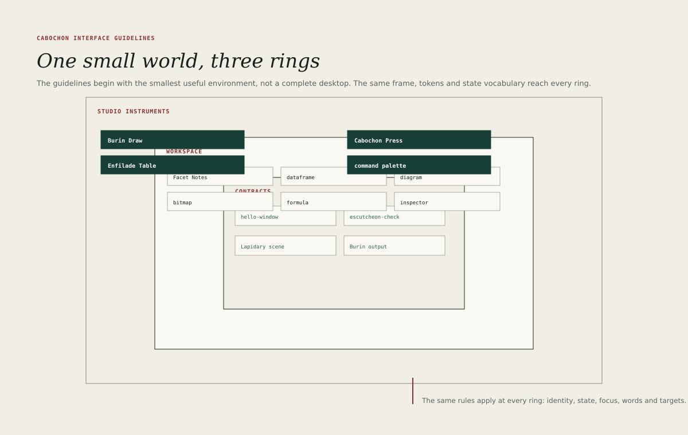

# Cabochon character

A Cabochon surface should feel like a well-made instrument on a quiet desk. The
screen holds one piece of work, the tools for that work sit close to it, and
the environment stays out of the way. Nothing glows for attention. Nothing
moves without a reason. The user can see what is saved, what is connected and
what has failed.

That impression is not decoration. It follows from four structural choices that
recur throughout this book.

## Compact rather than cramped

Cabochon inherits its density from the Graphics Environment Manager and from
the small workstations that GEM served. A 28-pixel tree row, a 29-pixel menu
bar and a 31-pixel title bar allow a useful document to fill a modest display.

Density is not an excuse for crowding. The compact metrics assume generous
internal padding, a clear type scale and a strict separation between planes. An
application that removes padding to fit more controls has misunderstood the
style: the result is cramped, not compact.

- A row must remain at least 28 pixels high.
- A primary target must remain at least 36 pixels high.
- Text must never fall below the sizes in [Typography](13-typography.md).

## Document-centred rather than application-centred

The document is the subject of the window. The application is the instrument
that edits it. A Cabochon window therefore gives the document the largest
plane, names it in the title bar, and keeps persistent chrome to a narrow rail,
a masthead, a menu bar and a status line.

The user should be able to move from a note to a dataframe to a diagram without
feeling that the environment has changed its personality. The same pane heads,
the same inspector, the same status line and the same state chips appear in
each application, even when the content differs.

## Liberal rather than paternal

Cabochon assumes that the user owns the work. The environment must not hide the
file format, refuse an export, rewrite a document silently or require an
account to open local content. Where a choice is genuinely the user's, the
interface should present it plainly and remember it.

Liberality has limits. It does not extend to letting an application take
authority it was not granted, or to letting a provider turn a live object into
an opaque image without saying so. The
[live relationship states](08-live-relationships.md) exist to keep freedom and
honesty together.

## Practical rather than ornamental

Every ornament must work. A rule separates planes. A tint marks a state. A
shadow lifts a floating surface. A texture would do none of these things and
therefore does not belong.

Cabochon draws with flat fills, one-pixel keylines, a restrained palette and
two weights of type. The result should look inevitable rather than decorated,
in the way that a good technical drawing looks inevitable.

## What the character rules out

The following are outside the Cabochon character, even when a platform makes
them easy.

- Gradients used as decoration, glass effects or blurred translucency.
- Rounded corners larger than 2 pixels on document planes.
- Icons drawn in several colours when one ink and one accent will do.
- Animated transitions that delay the user's next action.
- Modal interruptions for routine, reversible operations.
- Toolbars that grow with every new feature instead of yielding to menus,
  the inspector or the command palette.

## A test for new surfaces

Before adding a surface, the designer should answer four questions.

1. Does it hold a document, an object or a tool for the current selection?
2. Can the user reach it with the keyboard, and leave it without a pointer?
3. Does it reuse the window, pane, control and state vocabulary in this book?
4. Would the surface still make sense if every other Cabochon application
   disappeared?

A surface that fails the fourth question is probably a feature of one
application rather than a member of the environment. It may still be built, but
it should not establish a new pattern.
