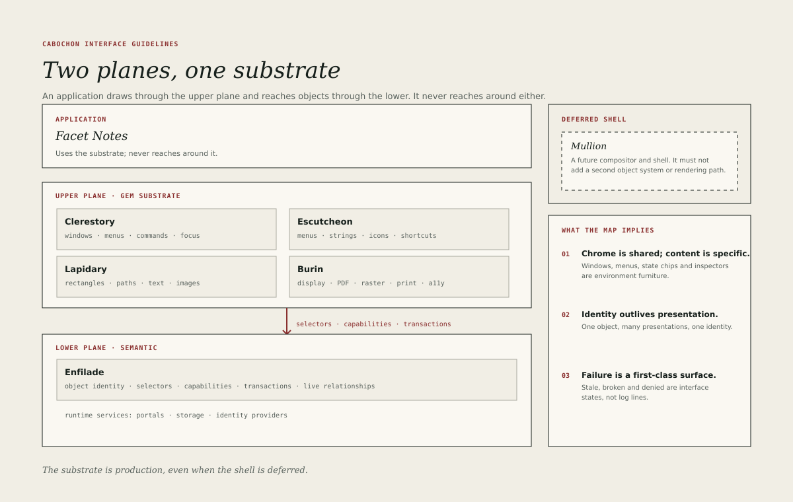

# Ecosystem map

Cabochon has two planes. The upper plane is the GEM-derived application and
graphics substrate: Clerestory for interaction, Lapidary for device-independent
scenes, Burin for rendering and Escutcheon for declarative resources. The lower
plane is semantic: Enfilade identifies objects, resolves selectors, checks
capabilities and coordinates transactions.

An application sits on the upper plane. It draws through Lapidary, renders
through Burin and loads its menus and strings from Escutcheon. When it needs to
reach a semantic object or invoke a tool, it does so through Enfilade and the
runtime services beneath it. It does not reach around the substrate to a
private renderer or a private object store.

## The substrate components

| Component  | Responsibility                                                         |
| ---------- | ---------------------------------------------------------------------- |
| Clerestory | Application environment: windows, menus, commands, focus, dialogs.     |
| Escutcheon | Declarative resources: menus, strings, icons, shortcuts, layout.       |
| Lapidary   | Scene description: rectangles, paths, text, images, clips, transforms. |
| Burin      | Output: display, PDF, raster, thumbnail, clipboard, print, a11y tree.  |
| Enfilade   | Object identity, selectors, capabilities, transactions, live links.    |
| Mullion    | A future compositor and shell, deliberately deferred.                  |

The names come from stonework and from GEM's own vocabulary. They are useful
because they keep responsibilities distinct: Clerestory is not a renderer,
Lapidary is not an object store, and Enfilade is not a drawing model.

## The runtime boundary

In the first small world, Cabochon runs as an application runtime inside GNOME
or KDE Plasma. The host desktop owns the session, the input devices and the
window decorations. Cabochon owns the application contract, the scene contract,
the output contract and the semantic layer.

This split is not scaffolding. A hosted Cabochon application must still use
Clerestory, Lapidary, Burin and Escutcheon as production contracts. A future
Mullion shell would add composition and shell integration; it must not
introduce a second object system or a second rendering path.

The practical consequence for interface design is that Cabochon cannot assume
control of global menus, global shortcuts or the lock screen. It adapts its
windows to the host's window management, and it uses XDG portals for files,
printing, notifications and capture. The [window chapter](09-windows.md)
describes the adaptation.

## Applications and instruments

The first batch divides into three groups.

- **Reference applications** prove a contract. `hello-window` proves the
  Clerestory application contract; `escutcheon-check` proves the resource
  format; the Lapidary and Burin contract fixtures prove scene and output
  parity.
- **Workspace instruments** do the everyday work: notes, dataframes,
  diagrams, bitmaps, the formula tool, the inspector and the project window.
- **Studio tools** stress the furniture: Burin Draw, Cabochon Press and
  Enfilade Table.

The groups share one visual language. A reference application is not exempt
from the guidelines because it is small, and a studio tool is not exempt
because it is complex.

## What the map implies for design

Three consequences follow from the topology.

1. **Chrome is shared, content is specific.** The window, menu bar, tool strip,
   status line, inspector and state chips are environment furniture. The
   canvas, grid or page inside them belongs to the instrument.
2. **Identity outlives presentation.** A currency object shown in a note, an
   inspector and a print proof is one object with three presentations. The
   interface must never suggest that the three views are three documents.
3. **Failure is a first-class surface.** Because objects can be remote, live or
   unavailable, every instrument needs a way to show a relationship that is
   stale, broken or denied. The [state chapter](08-live-relationships.md)
   supplies the vocabulary.

## Reading the rest of the book

A reader who remembers only the map should remember this: Cabochon is an
application environment with a semantic layer, not a desktop with plugins. The
guidelines protect the environment's coherence so that the semantic layer can
be useful without becoming visible machinery.
