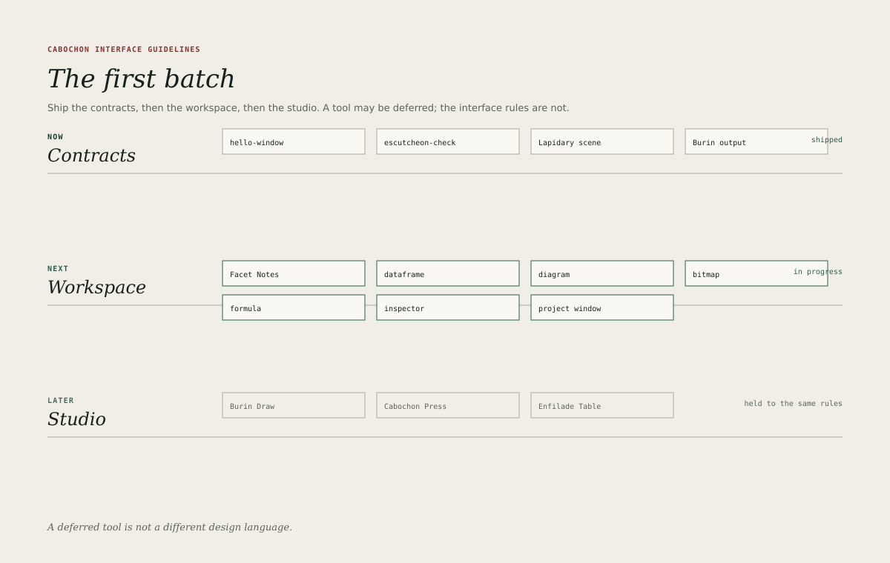

# The first batch

The first batch is deliberately small. It exists to prove that one object
environment can support real work, not to compete with an established desktop
on feature count. Three bands make up the batch, and all three share the
furniture described in this book.

The batch is a delivery phase, not a conformance profile. The profiles are
substrate, semantic workspace and studio, as
[References](appendix-references.md) defines. The studio band is prospective:
this book states what a studio instrument must do when it is built, and it does
not claim that the first release is a desktop-publishing package. Where the
platform design's initial proving ground limits document types, that limit is
reconciled in the programme documentation rather than overridden here.

## The contracts band

The contracts band fixes the boundaries that later work would otherwise
renegotiate.

- `hello-window` proves the minimum Clerestory application: a window, a menu
  bar, a command surface, a document plane, a status line, focus traversal and
  accessible roles, all loaded from Escutcheon resources.
- `escutcheon-check` proves the resource format: menus, strings, icons,
  shortcuts, command metadata, dialog layout and localization hooks.
- The Lapidary fixture proves that one scene renders consistently to display,
  PDF, print, thumbnail, raster, clipboard, accessibility, hit map and manifest.
- The Burin fixture proves the output contract, including failure behaviour,
  hit-testing geometry and the manifest.

A contract application is not a demo. It is the smallest program that would
break loudly if the contract regressed, and it is reviewed with the same care
as a user-facing instrument.

## The workspace band

The workspace band contains the everyday instruments: Facet Notes, the
dataframe editor, the Mermaid diagram editor, the bitmap editor, the formula
tool, the inspector and the project window.

These instruments must satisfy one another. A dataframe embedded in a note must
open in the dataframe editor without conversion. A diagram must keep its source
when its presentation is refreshed. A bitmap must update every presentation
when one is edited. A formula must be able to read a cell, a note entity or a
diagram element through the same selector discipline.

The workspace is where a user forms a first opinion of Cabochon. If the
instruments feel like separate programs that happen to share a colour scheme,
the object model has failed at the surface even if it works underneath.

## The studio band

The studio band applies the same furniture to heavier work: Burin Draw for
raster and vector composition, Cabochon Press for page layout and preflight,
and Enfilade Table for dense typed data.

The studio tools are allowed to be denser and more specialist, but they are not
allowed to invent a second interface language. A studio tool that needs a new
control should add it to the shared gallery in [Controls](19-controls.md)
rather than growing a private one.

## What coherence requires

The batch is coherent when six statements hold across every application.

1. Windows use the same title bar, menu bar, tool strip, status line and state
   chip grammar.
2. Panes use the same heads, splitters and minimum widths.
3. Objects keep their identity when they move between instruments.
4. Every live relationship shows one of the agreed states.
5. Every advertised command resolves to one canonical record with a menu home,
   and appears in the palette where that is useful. The palette, the tool strip
   and context menus are views of the record, not separate command lists.
6. The same document exports to display, print and raster with the same
   geometry and text.

The [conformance checklist](40-checklist.md) turns these statements into review
questions.

## What is deferred

The batch does not attempt a full desktop shell, a system settings application,
a file manager, a terminal, a mail client or an office suite. It does not
select a final compositor, renderer or accessible dynamic language. It does not
provide organization-only policy or fleet controls.

Deferral is a design decision, not an omission. Every deferred surface would
add furniture that the batch has not yet justified. The first batch should
prove that the furniture is right before it is multiplied.

## Acceptance for the batch

The batch is ready for wider use when a person can complete a representative
piece of knowledge work — gather sources, write a note, insert a dataframe,
edit a diagram, compute a value with the formula tool, export a proof — without
leaving the environment, and without seeing two different ideas of what a
window, a selection or a saved object is.

That is a modest sentence with a large consequence. It is the standard the
remaining chapters serve.
