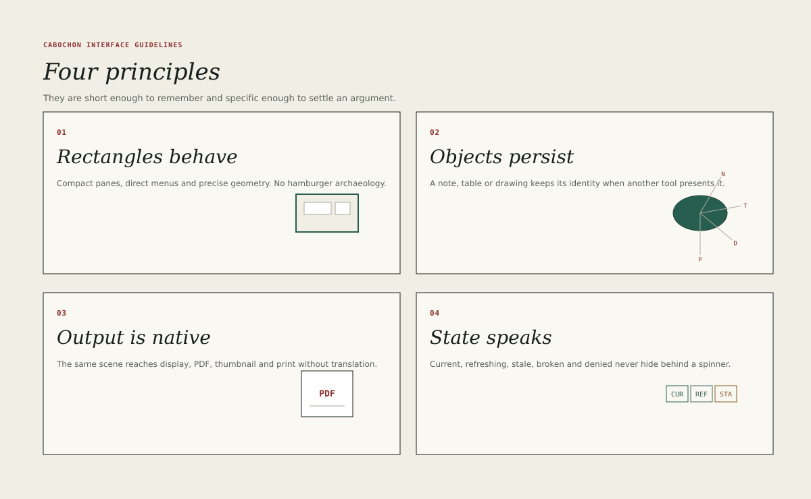

# Principles

Four principles govern every Cabochon surface. They are short enough to
remember during a design argument and concrete enough to settle one.

## Rectangles behave

A rectangle that looks like a control should act like a control. A window frame
drags. A pane splitter resizes. A row selects. A button depresses. A scrollbar
scrolls. A border that is merely decorative must not respond to the pointer,
and a control must not hide inside a picture.

The principle exists because document environments accumulate surfaces that
look interactive but are not: a thumbnail that behaves like a label, a toolbar
area that swallows clicks, a panel edge that cannot be dragged. Users build a
model of the interface from its rectangles, and every broken promise costs them
a moment of confusion.

- Hit regions must match the visible shape, with at least the minimum target
  size from [Toolbars and status](11-toolbars-status.md).
- A control must show hover, pressed, focused and disabled states.
- A surface that cannot be interacted with must not use a control's keyline,
  fill or cursor.

## Objects persist

An object keeps its identity when it is copied into a document, reopened,
exported or shown in another application. The presentation may change; the
object does not become a picture of itself.

The user-visible consequence is that Cabochon distinguishes *duplicate* from
*copy as image*, and *open in another instrument* from *export*. A note that
embeds a dataframe holds a reference to the dataframe, not a screenshot. The
[object identity](07-object-identity.md) and [embeds](32-embeds.md) chapters
describe the rules.

## Output is native

Every object that appears on screen can also be printed, exported to PDF,
rendered as a raster image, copied with usable geometry and read by an
accessibility client. Output is not a screenshot of a window; it is a second
rendering of the same resolved scene through a different Burin target.

Parity is claimed between outputs of the same declared intent, not between every
visible pixel and every file. A print intent may choose a different presentation
for a live object, and that choice is recorded. Application chrome, guides,
grids and selection handles are excluded from document output by the
participation policy, while state marks that belong to an object remain. A
diagnostic whole-interface export is a separate operation that declares that it
includes chrome.

The principle forbids a class of shortcuts: drawing directly to the screen,
composing a PDF from a separate code path, or treating accessibility as a text
dump attached after the fact. The [output parity](37-output-parity.md) chapter
states the intents, the participation policy and the tolerances.

## State speaks

The interface says what it is doing. A save is visible. A background refresh is
visible. A broken source is visible and explained. A denied capability is
visible without revealing the protected value. Silence is reserved for the
normal, current, saved state.

The principle is the basis for the
[live relationship states](08-live-relationships.md), the status line, the
state chip and the error vocabulary. It also governs progress: an operation
that takes longer than 200 milliseconds must announce itself, and an operation
that finishes must say so once.

## Resolving conflicts

The principles can pull against one another. A dense inspector satisfies
*objects persist* by showing identity, but may crowd *rectangles behave* if its
rows fall below the minimum target size. A live refresh indicator satisfies
*state speaks*, but may distract from the document.

The order of precedence is:

1. **Output is native.** A surface that cannot be exported or read is not a
   Cabochon surface, however elegant.
2. **Objects persist.** Identity is the reason the environment exists; a
   presentation shortcut that destroys it is not acceptable.
3. **State speaks.** The user must be able to tell what happened.
4. **Rectangles behave.** Interaction truthfulness follows from the three
   above, and is never traded away for visual tidiness.

When two options satisfy the higher principles equally, choose the one that
requires fewer pixels and fewer words.

## Applying the principles to a new feature

A designer should be able to answer four questions before building.

- Which rectangle will the user act on, and what does it promise?
- What object does this surface present, and does the object survive the
  interaction?
- What does this surface look like in print, in an export and in an
  accessibility tree?
- What does the surface say when it is working, when it is waiting and when it
  has failed?

A feature that cannot answer all four is not yet designed.
