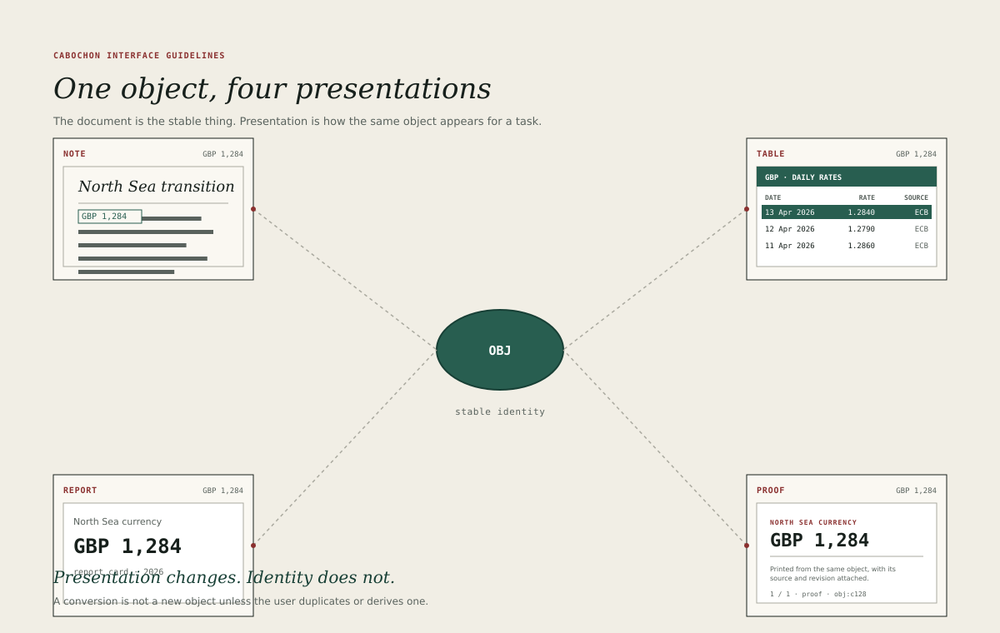

# The document at the centre

A Cabochon window is organized around a document, not around a feature
inventory. The document occupies the largest plane. The instrument's controls
sit at the edges, in a rail, a masthead, a menu bar, a tool strip, an inspector
or a status line. The document is never the leftover space after the chrome has
taken what it wants.

The Étoilé mockups of 2007 remain a useful reference for the feel: a page-like
document, generous margins, a small set of instruments and a sense that the
screen is a desk rather than a dashboard. Cabochon adopts the orientation
without copying the ornament.

## The document plane

The document plane must be visually distinct from the surrounding chrome. In
the light theme it is `#FAF8F2` against a `#F1EEE5` work surface; in the dark
theme it is `#1B2420` against `#121816`. A one-pixel keyline separates the
plane from its neighbours.

Rules for the plane:

- The plane must receive the largest share of the window at every supported
  size.
- A document must not be inset by more than 16 pixels on any side unless the
  instrument is a page-layout tool showing a physical page.
- The plane must scroll, zoom and pan without moving the surrounding chrome.
- A document's title must appear in the title bar, not only in a tab or a
  breadcrumb.

## Chrome proportions

At a 1280 by 800 window, the horizontal chrome bands — masthead, title bar,
menu bar and status line — should not exceed roughly one fifth of the area.
Those bands total 130 pixels, about 16 per cent, when the optional 44-pixel
masthead is present.

Side panes are budgeted separately, because they hold working content rather
than chrome:

- a 126-pixel rail when the instrument has a persistent category list;
- a 240-pixel inspector when the instrument has one.

At the default 1280 by 800 window with both side panes and the horizontal
bands, the document plane is 914 by 670 pixels, about 60 per cent of the
window. The binding test is that the document plane remains the largest region
and at least 420 pixels wide. When a window cannot hold both panes and that
width, an instrument collapses a pane rather than shrinking the document.

An instrument that needs more chrome should first ask whether a pane, a sheet
or the command palette would serve better. Chrome is persistent; a sheet is not.

## One object, many presentations

The figure shows the central claim of the environment. A single currency object
appears as a compact inline value in a note, a detailed table in the dataframe
editor, a labelled card in a report and a print-ready block in a proof. The
four surfaces are presentations of one object with one identity.

Presentations differ in what they show and how much they show. They do not
differ in what the object *is*. A designer must therefore avoid language that
suggests otherwise: the interface should say "open the object", not "open a
copy"; "change the presentation", not "convert"; "insert a reference", not
"paste the values".

Each presentation is resolved for a declared intent. The same object may have a
display presentation, a print presentation and a thumbnail presentation, and
those are not required to be pixel-identical. They are required to describe the
same object, the same accepted revision and the same state. A change of print
presentation is a recorded choice, not a conversion of the object, and a
paginated page layout is not compared with a scrolling editing view as though
the two were the same projection.

## Documents and instruments

An instrument is replaceable. A document is not. Facet Notes may be replaced by
a better note editor, but the notes it wrote must open in the replacement.
Enfilade Table may gain a new view, but the table object must remain the same
table.

This asymmetry has a practical test: if the application were removed tomorrow,
could the document still be opened, read, printed and exported by another
Cabochon instrument? If not, the document has been imprisoned in the
application, and the design has failed the *objects persist* principle.

## The document header

Where an instrument shows a document, the top of the document plane should
carry a compact header with four pieces of information:

1. the document's name, editable in place;
2. its object identity in a copyable form, available from a menu rather than
   shouting in the header;
3. its live state, if it has one;
4. the primary action for the instrument, such as **Share**, **Export** or
   **Publish**.

The header must not become a second toolbar. If it accumulates more than one
action, the rest belong in the menu bar or the command palette.

## When the document is absent

An empty window must still be a document window. It should show the
instrument's name, a short explanation of what the instrument does, and the two
or three ways to begin: create, open or insert. An empty state is not a
marketing page, and it must not hide the menu bar or the keyboard path that
would create the first document.
