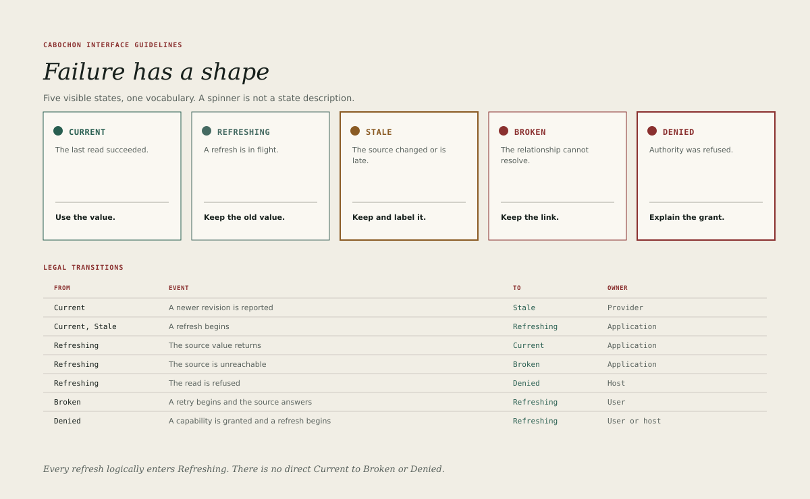

# Live relationships

An object that reads from a source — a currency rate, a dataframe cell, a note
entity, a diagram element — has a relationship with that source. The
relationship can be current, refreshing, stale, broken or denied. Each state
has a distinct appearance and a distinct promise.

## The five states

| State      | Meaning                                             | Appearance            |
| ---------- | --------------------------------------------------- | --------------------- |
| Current    | The value matches the source at its known revision. | Pine text or chip.    |
| Refreshing | A refresh is in progress; the last value is shown.  | Teal chip, no alarm.  |
| Stale      | The source changed and the value has not refreshed. | Amber ink chip.       |
| Broken     | The source cannot be reached or no longer exists.   | Oxide chip.           |
| Denied     | The capability to read the source was refused.      | Oxide chip, no value. |

The states are exhaustive for the first batch. An application must not invent a
sixth state, and must not use colour alone to distinguish them. Every chip
carries a word.

## Transitions

A state change names its event and its owner. The first batch permits only the
following transitions.

| From           | Event                                        | To         | Owner        |
| -------------- | -------------------------------------------- | ---------- | ------------ |
| Current        | The source reports a newer revision          | Stale      | Provider     |
| Current, Stale | A refresh begins                             | Refreshing | Application  |
| Refreshing     | The refresh returns the source value         | Current    | Application  |
| Refreshing     | The source is unreachable                    | Broken     | Application  |
| Refreshing     | The read is refused                          | Denied     | Host         |
| Broken         | A retry begins and the source answers        | Refreshing | User         |
| Denied         | A capability is granted and a refresh begins | Refreshing | User or host |

Every refresh enters **Refreshing** logically, even when it completes too
quickly to paint the chip. A relationship does not move from **Current**
straight to **Broken** or **Denied**, and a **Broken** relationship does not
become **Stale**: without a source there is no newer revision to report.

## Recoverability is a transition, not a state

A relationship that can recover does not need a sixth label. Recovery is the
transition back to **Current**, and the interface should preserve the last
successful value while that transition is possible.

This rule matters most for **Broken** and **Denied**, where the temptation is
to erase the value and replace it with an error. Erasing destroys the user's
context and may destroy work. The correct behaviour is:

1. preserve the last committed value in protected storage, and display it for
   **Broken** but never for **Denied**;
2. explain what failed in one sentence;
3. offer the action that can restore the relationship, if one exists;
4. return to **Current** without a modal interruption when the source
   recovers.

## Refresh

A refresh must be visible but quiet. The **Refreshing** state uses the teal
accent, which is reserved for motion and decoration and never used for
body-size text. A refresh that completes quickly may skip the chip entirely,
provided the value updates and the status line records the time.

Rules for refresh:

- A manual refresh must be available from the object's menu and the command
  palette.
- A background refresh must not move focus or steal a click.
- A refresh must not change a value the user is editing until the edit is
  committed or abandoned.
- The status line should show the last successful refresh time, not a
  countdown.

## Stale

Stale is the most commonly misunderstood state. It means the source is known to
have changed, the cached value is still readable, and the user should decide
whether to refresh. Stale is not an error.

- Use amber ink `#8A5B24` for the chip and its label at body size.
- Amber `#B8792E` may be used for a large icon or a 3-pixel rule, never for
  small text.
- The stale value remains selectable, copyable and printable.
- The object's menu offers **Refresh now** as its first item.

## Broken and denied

Broken and denied look similar and mean different things. Broken says the
source is gone or unreachable. Denied says the source exists but the
application may not read it.

The interface must not reveal a denied value, not even in a tooltip, a preview,
a thumbnail or an accessibility label. A denied object shows:

- the object's name, if the name itself is not protected;
- the word **Denied**;
- the name of the capability that was refused, in plain language;
- a way to request the capability or ask an administrator, where the host
  supports it.

A broken object shows the word **Broken**, a one-sentence diagnosis drawn from
the provider, and a retry action. It must not show a stack trace, an internal
error code as the primary message, or a blank rectangle with no explanation.

## Embeds that are not resolved

An embed has a resolution state, which is separate from the live relationship
state. Resolution asks whether this machine can turn the envelope into a
presentation at all.

| Resolution  | Meaning                                        | What the embed shows                |
| ----------- | ---------------------------------------------- | ----------------------------------- |
| Resolved    | A provider loaded the object                   | The presentation and its live state |
| Opaque      | Bytes intact; no provider is installed         | Export original                     |
| Unavailable | The provider exists but cannot load the object | Name, identity, retry               |
| Malformed   | The provider exists and rejected the payload   | Name, identity, diagnosis           |

Only a **Resolved** embed has a live relationship state. An embed that is
Opaque, Unavailable or Malformed has no Current, Refreshing, Stale, Broken or
Denied chip; its resolution state takes the chip. The two axes are never
combined into a single label.

Once resolved, every embed carries exactly one live state. An object with no
external source is **Current**, because it matches its stored revision.

Opaque is not an error. It is a promise that the document has kept the content
even though this machine cannot show it. The placeholder must say so, and must
offer **Export original** so that the bytes can leave the environment intact.

## Testing the states

A state is correctly implemented when a reviewer can produce it on demand and
observe four things: the right word, the right colour, the value policy and the
correct recovery action. The value policy is part of the state: Stale and
Broken preserve and display the last value; Denied preserves it only in
protected storage and displays none of it.

Test **Denied** by seeding a canary value in the source and confirming that it
appears in no text, tooltip, preview, thumbnail, accessibility label or
diagnostic. Exercise every transition in the table above. The
[checklist](40-checklist.md) lists the transitions that must be witnessed
before release.
