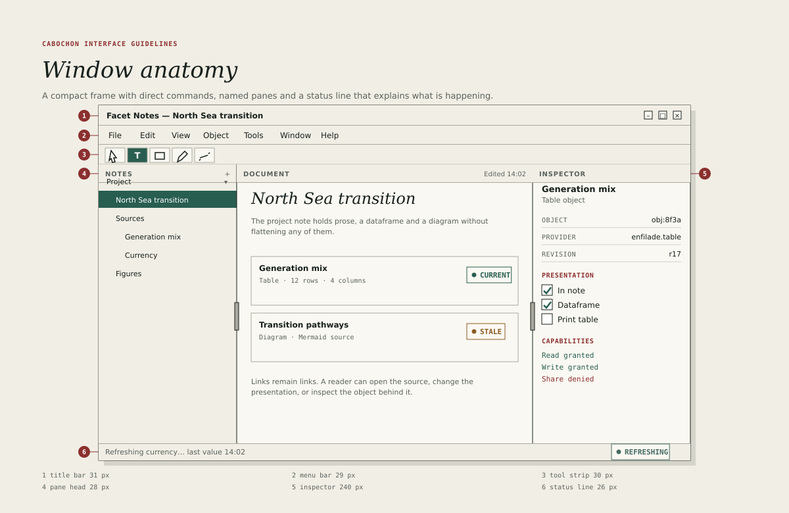

# Windows

A Cabochon window is assembled from a fixed set of horizontal bands. The bands
give every application the same rhythm and make a window recognisable before
its contents are read.

## The bands

The metrics below are production values at 100 per cent scale.

| Band        | Height | Contents                                           |
| ----------- | ------ | -------------------------------------------------- |
| Title bar   | 31 px  | Title, object state, window controls.              |
| Menu bar    | 29 px  | Top-level menus, right-aligned status if required. |
| Tool strip  | 30 px  | Frequent commands, grouped and separated.          |
| Document    | Fill   | The document plane and its panes.                  |
| Status line | 26 px  | Message, progress and state chip.                  |

The bands are stacked without gaps. A one-pixel rule in `#AAA99F` separates the
window from its work surface and the document plane from the chrome.

## Title bar

The title bar carries the document's name, left-aligned in the left-to-right
layout. It may also carry a small state chip when the document has a live
relationship that is not **Current**. The chip sits to the right of the title
and must not displace the window controls.

Rules for the title bar:

- The title must be the document's name, not the application's name. When no
  document is open, it may name the instrument.
- The title must truncate in the middle, preserving the beginning and the
  extension, rather than at the end.
- Window controls are minimise, maximise and close, in that order, with a
  12-pixel glyph inside a 22-pixel target.
- A modified document appends a single bullet, not the word "modified".
- Double-clicking the title bar must perform the host's configured action.

Cabochon does not draw its own window decorations in hosted mode. The host
desktop supplies the frame, the shadow and the resize handles. The title bar
described here is the application's internal header, which remains when the
host draws decorations outside it.

## Menu bar

The menu bar follows the ordering rules in [Menus](10-menus.md). It must remain
visible at every window size; an application must not collapse its menus into a
hamburger button. When the window is too narrow, overflow items move into a
final **More** menu.

## Tool strip

The tool strip is optional. It holds commands that the user invokes repeatedly
and that benefit from a visible, one-click target. It is not a place for every
command, and it must not grow beyond one row.

A tool strip button is 30 pixels square with a 16-pixel glyph. Related buttons
are grouped with a 9-pixel gap and separated from the next group by a one-pixel
vertical rule with 6 pixels of space on each side. The strip must carry a text
label for any command whose icon is not universally understood.

## Document area

The document area holds the instrument's panes. It must not be inset by a frame
of its own; the window's keyline is the only border. A document that needs a
visible page, such as a print layout, draws that page inside the area with its
own margin and shadow.

## Status line

The status line is always present in a document window. Its left side carries a
short message about the current operation or selection. Its right side carries
the document's state chip and, where relevant, a progress indicator. The rules
are given in [Toolbars and status](11-toolbars-status.md).

## Window states

Cabochon distinguishes four window states.

- **Active** — the window receives input. Its title bar uses the paper fill
  and ink text.
- **Inactive** — the window is visible but not focused. Its title text uses
  the soft ink `#59625D`, and its controls remain legible.
- **Modal** — the window blocks its parent. It uses a sheet inside the parent
  where the host supports sheets, and a centred dialog otherwise.
- **Detached** — an inspector or palette that the user has torn off. It keeps
  the same furniture and gains a title bar of its own.

An inactive window must not dim its content below readable contrast. The
distinction between active and inactive is carried by the title bar and the
focus ring, not by a veil over the document.

## Size and position

- A window must open at a size that shows its document without horizontal
  scrolling at 1024 by 768.
- The minimum size must be declared per instrument, and must never be smaller
  than the sum of its pane minimums plus the chrome.
- The environment should restore the last size and position per document, not
  per application.
- A window restored onto a display that no longer exists must be moved onto
  the nearest available display rather than opened off-screen.

## Host adaptation

In hosted mode the window manager may add its own title bar, shadow and resize
border. Cabochon must not duplicate the host's controls or fight its placement
rules. Where the host provides server-side decorations, the application hides
its internal window controls and keeps its title and state chip. Where the host
provides client-side decorations, the application draws the full title bar
described above.

The test is simple: the window must look deliberate under both GNOME and KDE
Plasma, and must never show two sets of close buttons.
