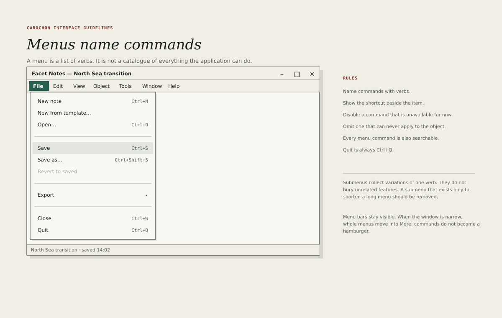

# Menus

The menu bar is Cabochon's complete command surface. Every command that changes
a document must be reachable from it. The command palette and the tool strip
are accelerators, not substitutes.

## Order

Menus appear in a fixed order, with instrument-specific menus inserted before
**Window**.

1. **File** — new, open, save, export, print, close.
2. **Edit** — undo, redo, cut, copy, paste, selection, find.
3. **View** — zoom, panes, presentation, appearance.
4. *Instrument menus* — **Insert**, **Format**, **Data**, **Page**, **Object**
   or similar, in the order the instrument's work flows.
5. **Window** — window list, new window, detached panes.
6. **Help** — documentation, keyboard reference, about, diagnostics.

The list gives each menu's internal order and its usual contents. An
application omits the items and menus it does not implement: one with no
editable document omits **Edit**, and one with a single window omits
**Window**. A menu that would be empty is never drawn.

Two commands have a fixed home even in a small application. **Command palette**
lives in the **View** menu and is never palette-only, because a shortcut that
is the only route to a surface is undiscoverable. **Inspect** and **Copy
identity** live in **Edit** whenever they can apply to the current selection. A
command that is advertised in a toolstrip, a context menu or the palette also
appears in its menu home; the menu is the complete inventory, and the other
surfaces are shortcuts to it.

An instrument must not rename **File** or **Edit**, and must not move **Help**
away from the end. A user who learns one Cabochon application should find the
same anchors in the next.

## Command records

Every advertised command resolves to one canonical record. A menu item, a tool
strip button, a context-menu item and a palette result are views of that
record, not independent definitions.

A record declares:

- its **semantic operation**, which is the stable identity used by tests and
  diagnostics;
- its **localized label**, which is a complete resource string;
- its **input requirement** — none, or further input required before the
  operation can run;
- its **availability predicate**, which says when it applies and when it is
  temporarily unavailable;
- its **shortcut**, if it has one;
- its **menu location**, including the contextual menu where it normally lives;
- its **invocation context requirements**, such as a selection, a document or a
  focused editable field.

The surfaces must agree on semantics and on input policy. They may differ in
invocation context: the same **Copy identity** record can appear in the Edit
menu, an object's context menu and the palette, and each invocation captures
its own target.

## Wording

Menu items are verb phrases in sentence case: **Insert reference**, **Refresh
now**, **Export plate**. A noun-only item is acceptable only when it names a
toggle or a property, such as **Rulers** or **Dark appearance**.

Rules for wording:

- Use the same verb everywhere for the same operation. If the toolbar says
  **Export**, the menu says **Export**.
- A menu label and its accelerator are resources, keyed by meaning and
  translated as [Localization](38-localization.md) requires. The menu never
  hard-codes an English string.
- Use an ellipsis when the command requires further input before it can act.
  The requirement is the test, not the shape of the surface that collects it.
- Do not use an ellipsis for a command that acts immediately.
- A command that opens a cancelable sheet still takes an ellipsis when it
  requires input. Cancellability is not the test, and neither is the
  presentation: a sheet, a modal dialog, a non-modal panel and an inline editor
  all take the ellipsis when they require input before acting.
- Prefer the specific verb to the generic one: **Insert reference** beats
  **Insert**, and **Export plate** beats **Export**.
- Do not use an ambiguous verb for a live object. **Save a copy** could mean
  duplicate, derive or export, so the menu uses the precise operation described
  in [Object identity](07-object-identity.md).

## Shortcuts

A shortcut is displayed right-aligned in the menu item, using the platform's
modifier names. Cabochon uses Control as the primary modifier on Linux, with
Alt for menu access and Shift for extension.

- A shortcut must be discoverable from the menu; the command palette displays
  the same string.
- A shortcut must remain stable across applications for the same operation:
  Control-S saves, Control-Z undoes, Control-F finds.
- An application-specific shortcut must not shadow a platform or accessibility
  shortcut.
- Single-letter shortcuts without a modifier are reserved for tools inside a
  canvas, and must be shown in the tool's tooltip.

## State marks

A menu item may show one of three marks.

- A **check** marks a toggle that is on.
- A **bullet** marks the selected option in a radio group.
- A **dash** marks a mixed state, such as a selection whose members disagree.

The mark occupies a 16-pixel column at the left of the item. Icons do not
appear in menus; the mark column is reserved for state, and mixing icons with
checks makes the state unreadable.

## Grouping and order within a menu

Items are grouped by purpose, with a one-pixel separator between groups. The
usual order is: create and open; save and export; share and print; destructive
items last. A destructive item is separated from the group above it and is
never placed next to a frequently used command.

Disablement is for a command that applies to this object but is temporarily
unavailable, such as **Paste** with an empty clipboard or **Undo** at the start
of history. It remains visible with a reason available on hover and to
accessibility clients.

A disabled menu item stays in the menu's roving navigation. Arrow keys reach
it, its reason is announced, and Enter or Space performs no mutation. Removing
it from the keyboard path would make the reason unreachable to the users who
most need it.

Absence is for a command that cannot apply to this object at all, such as
**Format cell** on a note. A command that can never act on the current object
must not be shown greyed; it is left out of the menu, the tool strip and the
context menu. The distinction is between "not now" and "not here".

## Context menus

A context menu is a subset of the menu bar, not a parallel command system. It
may contain only commands that apply to the object under the pointer, plus
**Inspect** and **Copy identity** where relevant.

A context menu has a **context target**, which is the object under the pointer
or the focused object when the menu is opened from the keyboard. The context
target is separate from the persistent document selection.

- Opening a context menu does not change the persistent selection.
- A command invoked from the context menu acts on the context target, which is
  visibly indicated by the menu's own header or by a transient outline.
- A command that is not effective on the context target is absent, even when it
  would be effective on the persistent selection.
- A selection command, such as **Select all**, is the exception: it names the
  selection as its target and says so.
- The invocation captures the context target, the document, the expected
  revisions and any local text selection. An asynchronous command does not
  retarget itself when the pointer moves or the selection changes.

Context menus must:

- open on the keyboard's context-menu key as well as the secondary button;
- close on Escape without changing the document;
- place the most specific command first;
- never contain a command that has no effect on the context target.

Contextual commands have a stable menu home when they apply to the current
selection. **Inspect** and **Copy identity** live in the **Edit** menu as well
as in the context menu, so that a keyboard user who never opens a context menu
can still reach them.

## Menu behaviour

- Pressing Alt focuses the menu bar. Arrow keys move between menus; Down opens
  one.
- Typing a letter jumps to the next item beginning with that letter.
- Escape closes the open menu and returns focus to the document.
- Opening a menu must not change the selection.
- A menu that would extend beyond the window flips or scrolls rather than
  clipping its last items.
- Menus must be reachable and operable with a screen reader, including their
  state marks and shortcuts.

## The More menu

When the window is too narrow for the full menu bar, whole menus move into a
final **More** menu in their original order. Individual items must not be
plucked out of their menus, because a menu's grouping carries meaning. The
**More** menu uses the same typography and marks as the menu bar.

**Help** remains last. If **Help** itself moves into **More**, it is the last
entry inside **More**, and the **More** label does not take Help's place at the
end of the visible menu bar. A user who looks for Help at the end of the bar
finds it in the overflow, not in a different position.
