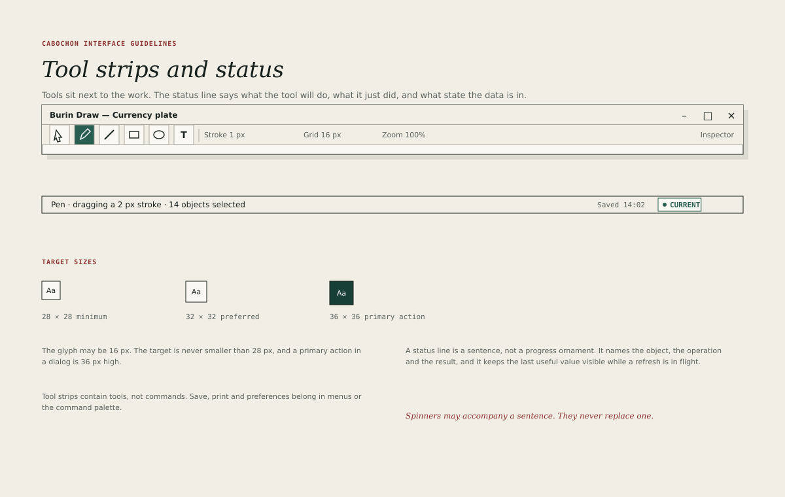

# Toolbars and status

The tool strip and the status line bracket the document. One holds the commands
a user reaches for repeatedly; the other holds the truth about what just
happened.

## The tool strip

The tool strip is a single 30-pixel row beneath the menu bar. It contains
between three and eight commands, grouped by purpose.

Geometry:

- button: 30 by 30 pixels;
- glyph: 16 by 16 pixels, centred;
- gap inside a group: 8 pixels;
- group separator: a one-pixel rule with 8 pixels on each side;
- text label: 12-pixel interface type, placed to the right of the glyph when
  the command needs one.

A tool strip button must have a tooltip that names the command and its
shortcut. The tooltip appears after 600 milliseconds and disappears when the
pointer leaves or a key is pressed.

### What belongs in the strip

A command belongs in the tool strip when all three statements hold.

1. It is used in the current document more often than once every few minutes.
2. Its effect is visible immediately.
3. It has a stable icon that a new user can learn from the tooltip.

Commands that open a dialog, change a setting or act on the whole project
belong in menus. A tool strip that has become a second menu bar should be
reduced, not reorganized.

### Target sizes

| Target          | Minimum | Preferred | Primary action |
| --------------- | ------- | --------- | -------------- |
| Pointer target  | 28 px   | 32 px     | 36 px          |
| Tool strip icon | 28 px   | 30 px     | —              |
| Menu item       | 28 px   | 30 px     | —              |
| Dialog button   | 32 px   | 36 px     | 36 px          |
| Window control  | 28 px   | 28 px     | —              |

The minimum is a floor for dense instruments such as Enfilade Table. A primary
action in a dialog must use the preferred size even when the rest of the dialog
is denser.

## The status line

The status line is 26 pixels high and spans the window. It has three zones.

- **Left.** A message about the current operation, selection or hover. It
  clears when the condition ends.
- **Centre.** Optional progress for a bounded operation, drawn as a 3-pixel
  rule that fills from left to right. Indeterminate progress uses a moving
  segment, not a spinner.
- **Right.** The document's live state chip and, when relevant, a count such
  as "12 rows selected".

Rules for messages:

- The status line must not show "Ready". Silence is the normal state.
- A message must be a complete sentence fragment, not an error code.
- A message that reports success must disappear after a few seconds; a message
  that reports a problem must remain until the problem is resolved or dismissed.
- The status line must not be the only place a destructive or failed operation
  is reported. It supports the document surface; it does not replace it.
- The status line must be exposed to assistive technology as a live region
  with polite priority.

## Progress

An operation that completes within 200 milliseconds needs no progress
indication. An operation that takes longer must show progress in the status
line, and may also show it in the document if the operation blocks editing.

- Determinate progress must show the completed proportion, not a fake
  percentage.
- Indeterminate progress must not imply completion.
- A cancellable operation must offer **Cancel** in the status line or the
  document, and the cancel action must take effect within 200 milliseconds.
- A completed operation must remove its progress and leave one message.

## The state chip

The state chip appears at the right of the status line when a document has at
least one live relationship. It uses the canonical vocabulary and colours of
[Live relationships](08-live-relationships.md): **Current**, **Refreshing**,
**Stale**, **Broken** or **Denied**. No other word, colour or icon substitutes
for one of those five.

A document may contain children in different states, so the chip is a computed
summary. It takes the first state that applies, in this order:

1. **Denied**, when any live child is denied.
2. **Broken**, when any live child is broken.
3. **Refreshing**, when any live child is refreshing.
4. **Stale**, when any live child is stale.
5. **Current**, when every live child is current.

The order is fixed so that a summary does not depend on the order in which
children were created or displayed. A mixed document must not hide a denied
child behind a milder summary. The chip's accessible name names the worst state
and the number of children in it, and each child keeps its own mark in the
document. The chip is a summary, not a notification, and never replaces the
per-object marks.

The chip is 20 logical units high with 11-unit metadata type and a 6-unit dot.
It must never be the only indication of a problem.

### What the chip does not report

The chip reports relationship state only. Persistence, draft validity and
resolution are independent facts and have their own carriers.

- **Persistence** — modified, saving, saved or save failed — appears as the
  title bar's modified mark and a status-line message. A save failure does not
  make a current relationship stale.
- **Draft validity** — a draft that does not validate — appears beside the
  draft. The last committed result keeps its own relationship state and is not
  presented as a fresh computation.
- **Resolution** — Resolved, Opaque, Unavailable or Malformed — appears on the
  embed itself and does not by itself change the chip.

A document with no live relationship shows no chip. The absence of a chip means
"nothing live to report", not **Current**, and it is not a defect. A document
whose only content is local and committed falls into the same case.

## When there is no tool strip

An instrument may omit the tool strip when its commands are all menu commands
or when its work is entirely canvas-based. It may not omit the status line. The
status line is the minimum evidence that the application participates in the
environment's state vocabulary.
