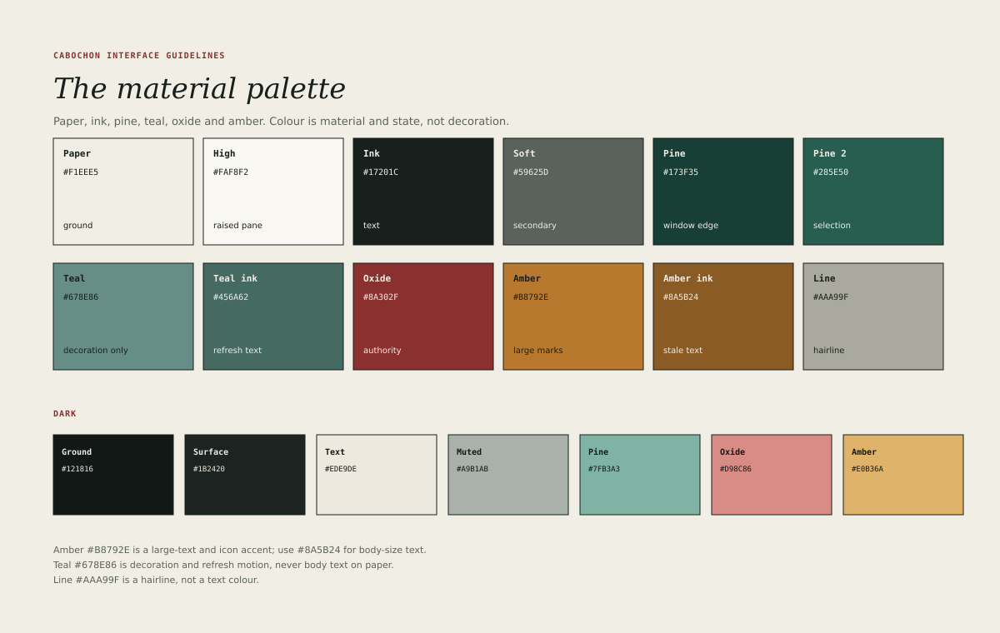

# Palette

Cabochon's palette is small, warm and material. It describes paper, ink,
polished stone and a few signal colours. Nothing in it is decorative: each
colour has a role, and every role has a contrast requirement.

## The light palette

| Token     | Value   | Role                                    |
| --------- | ------- | --------------------------------------- |
| Paper     | #F1EEE5 | Window ground and document surroundings |
| High      | #FAF8F2 | Raised pane, document plane, overlay    |
| Ink       | #17201C | Primary text and keylines               |
| Soft      | #59625D | Secondary text and metadata             |
| Pine      | #173F35 | Window edge, strong structure           |
| Pine 2    | #285E50 | Selection and primary button            |
| Teal      | #678E86 | Decoration and refresh motion only      |
| Teal ink  | #456A62 | Refresh text and small marks            |
| Oxide     | #8A302F | Authority, focus, destructive emphasis  |
| Amber     | #B8792E | Large marks and icons only              |
| Amber ink | #8A5B24 | Stale text at body size                 |
| Line      | #AAA99F | Hairlines and separators                |

## Contrast

Contrast is measured against the two light grounds, paper and high. The
following ratios are the production reference.

| Colour    | On paper | On high | Permitted use                         |
| --------- | -------- | ------- | ------------------------------------- |
| Ink       | 14.37    | 15.70   | Any text and keyline                  |
| Soft      | 5.44     | 5.94    | Secondary text at 12 px and above     |
| Pine      | 10.06    | 10.99   | Text and structure                    |
| Pine 2    | 6.45     | 7.04    | Text on high; selection fills         |
| Teal      | 3.13     | 3.42    | Decoration and motion, never text     |
| Teal ink  | 5.19     | 5.66    | Text and small marks                  |
| Oxide     | 7.11     | 7.77    | Text, focus ring, destructive accents |
| Amber     | 3.11     | 3.40    | 18 px text, icons and rules only      |
| Amber ink | 5.02     | 5.49    | Body-size stale text                  |
| Line      | 2.04     | 2.23    | Hairlines, never text                 |

Two further combinations are permitted: ink on amber at 4.61 and ink on line at
7.05. Both are used for compact labels on filled marks, and neither may be
inverted.

The rules that follow from the table are absolute.

- Teal must not carry text at body size. It is a wash, a rule or a moving
  indicator.
- Amber must not carry text below 18 pixels. Use amber ink for the same
  meaning at body size.
- Line must not carry text or an icon that is the only indication of state.
- No colour may be the only carrier of meaning. Every state also has a word,
  a shape or a position.

## Selection

Selection uses pine 2 as a fill with white text. A selected row in a tree, a
selected cell in a table and a selected object in a canvas all use the same
fill, so that selection reads as one idea across instruments.

A secondary selection, such as an inactive pane's remembered selection, uses a
pine-2 outline with an ink label. It must remain visible without competing with
the active selection.

## Focus

The focus ring is oxide, 3 pixels wide, offset 3 pixels from the control's
edge. Oxide is strong enough to be seen on every light ground and distinct from
selection. The ring must never be omitted for pointer users: a control that is
focused by any means wears the ring.

## Dark theme

The dark theme is a translation, not an inversion.

| Token   | Value   | Role                              |
| ------- | ------- | --------------------------------- |
| Ground  | #121816 | Window ground                     |
| Surface | #1B2420 | Raised pane and document plane    |
| Text    | #EDE9DE | Primary text                      |
| Muted   | #A9B1AB | Secondary text                    |
| Pine    | #7FB3A3 | Structure and links               |
| Oxide   | #D98C86 | Authority and destructive accents |
| Amber   | #E0B36A | Large marks and stale text        |

The dark theme keeps the same roles and the same restraint. It does not
introduce new hues, and it does not use pure black or pure white. Contrast must
meet the same thresholds; a colour that passes on paper does not automatically
pass on the dark ground.

## Tints and washes

A tint is a colour at low opacity over paper or high. Cabochon permits four.

- Pine 2 at 8 per cent for a selected-but-inactive row.
- Oxide at 6 per cent for an error region behind a message.
- Amber at 8 per cent for a stale region.
- Teal at 8 per cent for a refreshing region.

A tint must never be the only indication of a state, and a tinted region must
still meet text contrast against its own background.

## Choosing a new colour

The palette is closed for the first batch. An instrument that believes it needs
another colour should first check whether it needs another *role*. If it
genuinely does, the role and its contrast ratios belong in this chapter and in
the generator before the colour appears in an interface.
