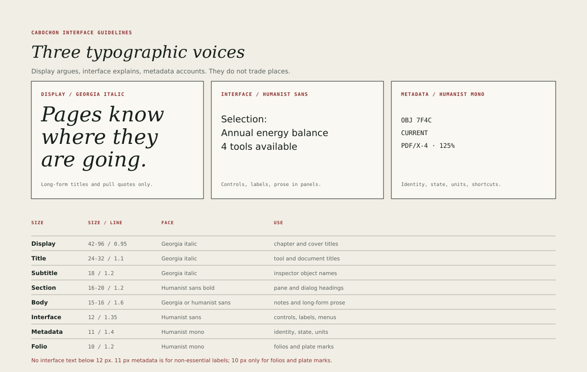

# Typography

Cabochon uses three typographic voices. Display argues, interface explains and
metadata accounts. They do not trade places.

## The three voices

**Display** is Georgia italic, or a compatible serif with a true italic. It
appears in chapter and cover titles, plate marks, pull quotes and the titles of
studio documents. It is never used for controls, labels or running interface
text. The single **Subtitle** row at 18 pixels uses the same face for an
object's name at the head of an inspector; that is a title, not running text.

**Interface** is a humanist sans. It carries menus, labels, buttons, pane
heads, dialog text and short prose in panels. The reference figures use DejaVu
Sans. A platform may substitute another humanist sans with similar metrics and
must check the measured values in this chapter against the substitute.

**Metadata** is a humanist mono. It carries object identity, state words,
units, shortcuts, dimensions, timestamps and folios. The reference figures use
DejaVu Sans Mono. Monospace is a signal that a string is exact and copyable,
not a stylistic choice.

## The scale

| Voice     | Size / line height | Face               | Use                       |
| --------- | ------------------ | ------------------ | ------------------------- |
| Display   | 42–96 / 0.95       | Georgia italic     | Chapter and cover titles  |
| Title     | 24–32 / 1.1        | Georgia italic     | Tool and document titles  |
| Subtitle  | 18 / 1.2           | Georgia italic     | Inspector object names    |
| Section   | 16–20 / 1.2        | Humanist sans bold | Pane and dialog headings  |
| Body      | 15–16 / 1.6        | Georgia or sans    | Notes and long-form prose |
| Interface | 12 / 1.35          | Humanist sans      | Controls, labels, menus   |
| Metadata  | 11 / 1.4           | Humanist mono      | Supplementary metadata    |
| Folio     | 10 / 1.2           | Humanist mono      | Folios and plate marks    |

Sizes are logical units at the baseline text scale. The user's text scale
multiplies them; the floors below are floors at the user's chosen scale, not
ceilings that override it.

## Voice and essentiality

Voice and essentiality are different questions. Voice says which face and
rhythm a string belongs to. Essentiality says whether a person needs the string
to operate, identify, validate or copy something.

The operational floor is 12 units. It applies to every string that is
essential, whatever its voice:

- state words and state chips;
- column names, row headers and units;
- validation messages and diagnostics;
- control labels, help that explains availability, and field labels;
- object identity, revision, provider and other copyable metadata;
- values a user must read to act.

The 11-unit metadata row is for supplementary text only: a timestamp, a count
that is also available elsewhere, a secondary hint. Monospace does not lower
the floor. A string that is exact and copyable is essential even when it is
short.

The floors are binding.

- No essential interface text below 12 units.
- Metadata may be 11 units only when it is non-essential.
- 10 units is reserved for folios and plate marks, which are not required
  for operation.
- A control's label must never use metadata type merely to fit.

The design book's mockups used 9- and 10-unit labels to suggest density. At
production size those labels fail both legibility and contrast. The corrected
floors above preserve the density of the layout without shrinking the words.

## Pane and dialog headings

A pane head uses the 12-unit interface role in bold, not the section scale. The
section scale is for a heading inside a pane's content and for a dialog title.
The distinction keeps a pane head from competing with the document it frames.

A dialog title uses the section scale at 16 to 20 units. A document title uses
the title scale. Neither is a pane head.

## Weights and styles

- Interface text uses regular and bold only. A semibold may stand in for bold
  where the family lacks a true bold, but the two must not be mixed within one
  window.
- Display uses italic, with roman reserved for a title that must match a
  document's existing style.
- Underlining is reserved for links and for the access key in a menu label. It
  is not used for emphasis.
- Small capitals and letter-spaced capitals appear only in metadata kickers,
  at 0.06 em to 0.08 em. They are never used for sentences.

## Measure and alignment

- Long-form prose in a document plane should measure 60 to 75 characters per
  line. A notes pane narrower than 45 characters wraps its prose and grows its
  rows; it does not reduce the type scale below the operational floor or below
  the user's requested text scale. If the pane cannot show a usable measure, it
  collapses or the document moves to a wider window.
- Interface labels align to the leading edge of their container. Centred text
  is reserved for dialogs, empty states and short button labels.
- Numbers in tables use tabular figures and align to the trailing edge.
  Numbers in prose use the family's default figures.
- Hyphenation is permitted in long-form prose and forbidden in interface
  labels, menu items and titles.

## Truncation

Text that does not fit must be handled deliberately.

- Titles truncate in the middle, keeping the beginning and the extension.
- Menu items and button labels must not truncate; the control grows or the
  label shortens.
- Table cells truncate at the end with an ellipsis and reveal the full value
  in a tooltip and in the inspector.
- Metadata strings truncate at the end and remain copyable in full.

## Localization

The type scale must survive translation. A label that grows by 35 per cent must
not break its control; the layout should allow the label to wrap or the control
to grow. Pseudo-localization is part of the release gate, as described in
[Localization](38-localization.md).

## A test for a type choice

For any piece of text, the designer should be able to name its voice and its
row in the scale. A string that belongs to no row is a string that will drift.
The fix is to classify it, not to invent a size.
