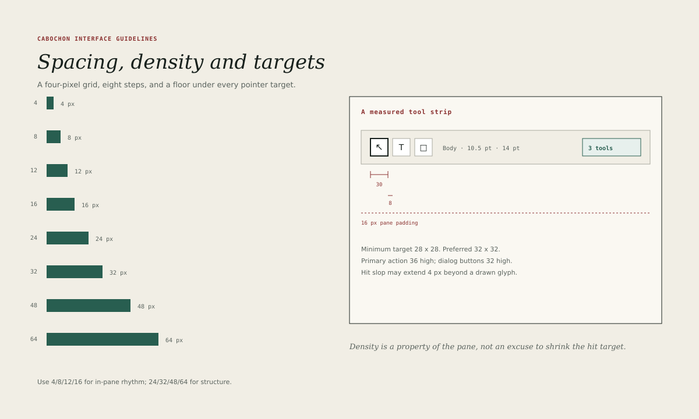

# Spacing and metrics

Cabochon measures in a four-pixel grid. The grid keeps unrelated instruments in
rhythm and makes a layout review a matter of arithmetic rather than taste.

## The scale

| Step | Use                                              |
| ---- | ------------------------------------------------ |
| 4    | Icon-to-label gap, hairline breathing room       |
| 8    | Gap between related controls, chip padding       |
| 12   | Gap between groups inside a pane                 |
| 16   | Pane padding, standard block gap                 |
| 24   | Separation between sections                      |
| 32   | Separation between major regions                 |
| 48   | Page margin in a document plane                  |
| 64   | Outer margin in a studio or presentation surface |

Use 4, 8, 12 and 16 for rhythm inside a pane; use 24, 32, 48 and 64 for
structure between regions. A value outside the scale is a defect unless it is a
measured component dimension, such as a 26-pixel status line.

## Pane padding

Every pane uses 16 pixels of padding on all sides. A pane head adds its own
28-pixel band above the content and aligns its title with the same 16-pixel
inset. A list row may reduce its horizontal padding to 12 pixels when it
carries a leading icon, but the inset from the pane edge remains 12 or 16,
never 10.

## Component dimensions

The shared dimensions are:

- title bar 31 pixels;
- menu bar 29 pixels;
- tool strip 30 pixels;
- tool button 30 by 30 pixels;
- pane head 28 pixels;
- tree and list row 28 pixels;
- status line 26 pixels;
- inspector 240 pixels;
- notes tree 210 pixels;
- rail 126 pixels;
- dialog button 32 pixels high, 36 for the primary action.

An instrument may not redefine these values. It may add a component, and that
component's dimension belongs in this chapter before it ships.

## Targets

The target is the region that accepts a pointer, not the glyph drawn inside it.

| Target        | Minimum | Preferred | Primary |
| ------------- | ------- | --------- | ------- |
| Any control   | 28 px   | 32 px     | 36 px   |
| Tool strip    | 28 px   | 30 px     | —       |
| Menu item     | 28 px   | 30 px     | —       |
| Dialog action | 32 px   | 36 px     | 36 px   |

A 16-pixel icon may sit inside a 28-pixel target; the target is the contract.
Hit slop may extend 4 pixels beyond a drawn glyph, but it must not overlap a
neighbouring target.

## Density

Density is a property of the pane, not an excuse to shrink the target. A dense
table may use 28-pixel rows and 11-pixel metadata; it may not use 20-pixel rows
or 9-pixel labels. Where an instrument needs to show more, it should use a
larger window, a collapsible pane or a zoom control.

## Alignment

- Labels align to the text baseline of their control, not to the control's
  vertical centre.
- Icons align to the optical centre of their target. A glyph with a heavy
  top, such as a triangle, sits 1 pixel lower than its geometric centre.
- Numbers in a column share a right edge.
- Pane heads across a window share a baseline, even when their bands differ in
  height by a pixel.

## Window sizes

The minimum window size is the sum of the pane minimums plus the chrome. The
default window is 1280 by 800, with a preferred content area of at least 960 by
600 after chrome. A window must remain usable at 1024 by 768, which is the
floor for the first batch.

## Checking a layout

A reviewer can check a layout with four measurements: the pane padding, the row
height, the gap between groups and the target size of the smallest control. If
those four are on scale, the rest of the layout is usually sound. The figure's
measured tool strip shows the method: every dimension is drawn and labelled, so
a disagreement is visible rather than argued.
