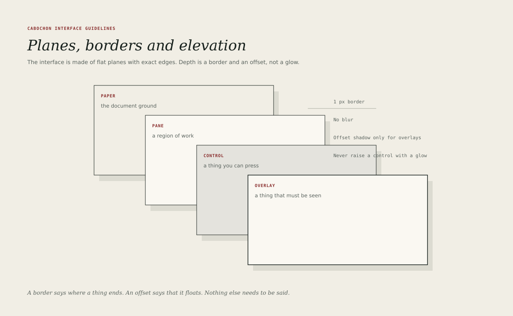

# Planes and borders

Cabochon is made of flat planes with exact edges. Depth is a border and an
offset, not a glow. The discipline keeps a dense window legible and prevents
the interface from turning into a stack of floating cards.

The rules in this chapter govern Cabochon chrome and the furniture the
environment draws over a document. They do not govern user-authored content: a
document may contain its own borders, radii, fills and shadows, and the
environment preserves them. A page-proof surface is the one place where a
document's physical edge is drawn as interface furniture, and it is declared as
an exception below.

## The four planes

| Plane   | Fill    | Role                                    |
| ------- | ------- | --------------------------------------- |
| Paper   | #F1EEE5 | The window ground and document surround |
| Pane    | #FAF8F2 | A region of work                        |
| Control | #E4E3DD | A thing that can be pressed             |
| Overlay | #FAF8F2 | A thing that must be seen               |

Paper is the default background of a window. Pane lifts a region of work one
step without pretending to float. Control is the fill of a pressable surface,
such as a button or a field. Overlay is a pane that genuinely sits above the
document: a menu, a popover, a sheet or a dialog.

The planes are distinguished by fill and a one-pixel keyline in ink or line.
None of them uses a gradient or a texture.

## Borders

- A keyline is 1 unit in ink for structural edges and in the decorative line
  role for internal separators.
- An overlay border is 1.5 units in ink, so that it remains visible over a
  busy document.
- A control that must be identifiable as a control uses the essential border
  role, not the decorative line. The essential border passes 3:1 against its
  actual adjacent surface; the decorative line does not and is not asked to.
- A focused control keeps its allocated border and gains the 3-unit focus ring
  outside it. The border is never removed to make room for the ring, because
  removing a layout-participating border would change the control's geometry.
- A disabled control keeps its border but loses its fill contrast and its
  text becomes soft.

Borders belong to the edge of a thing. A border drawn inside a pane to decorate
its content is a separator, and should use the decorative line role at 1 unit.

The distinction between a decorative line and an essential boundary is a
contrast rule, not a taste rule. A faint separator is acceptable. A faint field
edge is not, because the edge is the information that identifies the field.

## Radii

Corners are square. A 2-pixel radius is permitted on chips, state marks and
small buttons, where a square corner would look like a rendering fault. A
document plane, a pane, a window and a dialog are square. A radius larger than
2 pixels is outside the Cabochon character.

## Shadow

Cabochon permits exactly one shadow per application-owned overlay: an offset
beneath a menu, popover, sheet, dialog or tooltip. The rule is per overlay, not
per scene. A scene that contains a host-decorated window, a menu and a popover
may therefore show three shadows, each belonging to a different overlay and
each owned by whoever decorates that overlay.

- Offset: 12 pixels right and 14 pixels down for a menu or popover; 6 pixels
  for a small tooltip.
- Colour: ink at 9 per cent opacity, `#17201C18`.
- Blur: none. The shadow is a second rectangle, not a blurred halo.
- The overlay itself sits above the shadow with its 1.5-pixel border.

A window may also cast the host's shadow in hosted mode. The application must
not add a second one: the host owns that shadow and the application adds none
of its own for the same window.

A printed page presented as a physical sheet is the one declared exception. A
page-proof surface may draw a page shadow to show the paper edge, because the
shadow describes the page as an object rather than claiming a software layer.
It is drawn in the page-proof presentation, never on a document plane, and it
does not print. No other non-overlay surface gains a shadow.

## Elevation is not decoration

A plane is raised only when it must be seen above something else. A toolbar
does not float. A pane does not float. A button does not float. The moment a
surface gains a shadow, it makes a claim about layering that the rest of the
interface must respect.

The test is functional: if the surface were moved behind the document, would
the user lose information or an action? If not, it does not need elevation.

## Separators

Use a separator to divide groups inside one plane, not to divide planes.

- Horizontal separator: 1 pixel, line colour, full pane width minus the
  16-pixel padding.
- Vertical separator: 1 pixel, line colour, the height of the group it
  divides.
- A separator must not be used as a substitute for spacing. If 16 pixels of
  space is enough, no rule is needed.

## Dark theme

In the dark theme, paper becomes `#121816`, pane and overlay become `#1B2420`,
and control becomes `#26312C`. Decorative keylines use `#3A453F` rather than
ink, because ink is invisible on the dark ground. That keyline is about 1.59:1
against the surface and is therefore decorative only. An essential control
boundary uses `#74847B`, which passes 3:1 against the ground, the surface and
the control fill. The shadow becomes black at 40 per cent, with the same offset
and no blur.

## What to avoid

- Blurred shadows, glass, translucency and backdrop filters.
- Gradients, even subtle ones, on chrome or controls.
- Multiple nested borders around one region.
- A raised card for content that is not an overlay.
- Rounded corners on document planes or windows.
