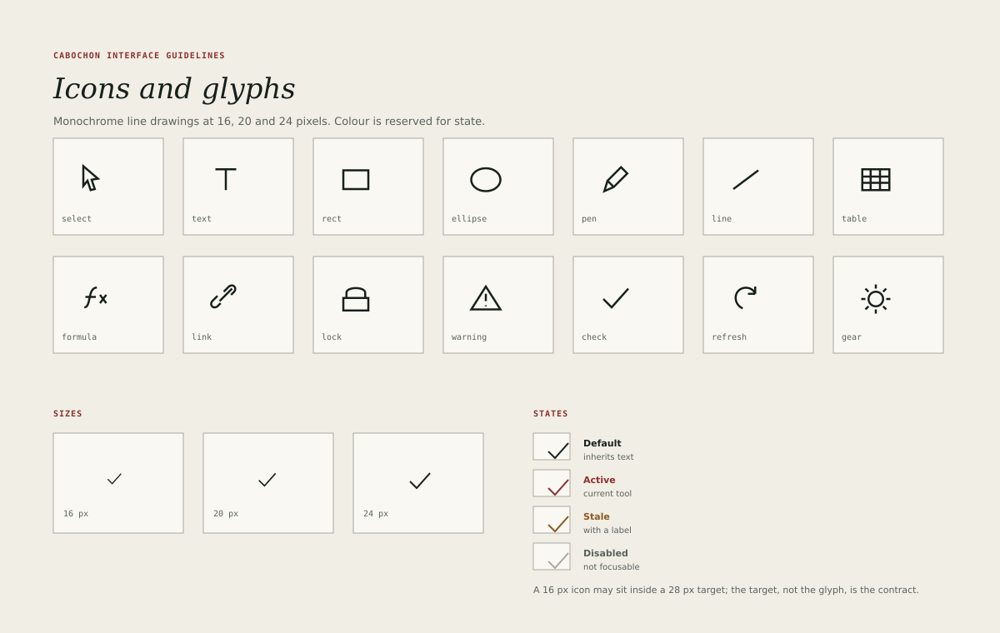

# Icons

Cabochon icons are monochrome line drawings. They are drawn on a 24-pixel grid
with a 2-pixel stroke, square caps and joins, and no fills except where a shape
must read as solid at small size, such as the selection arrow.

Colour is reserved for state. A default icon inherits the ink of its text. An
active icon uses oxide. A stale icon uses amber ink and is always accompanied
by a label. A disabled icon uses line and is removed from the focus order.

## Sizes

| Size | Use                                                       |
| ---- | --------------------------------------------------------- |
| 16   | Inline with metadata, table rows, tree leaves, tool strip |
| 20   | Compact controls and dense pane heads                     |
| 24   | Primary actions and standalone icon buttons               |

The stroke scales with the size: 1.25 pixels at 16, 1.5 at 20 and 2 at 24, so
that the optical weight stays constant. Icons are drawn at the target size, not
scaled from a single bitmap.

## The first vocabulary

The first batch uses fourteen glyphs: select, text, rectangle, ellipse, pen,
line, table, formula, link, lock, warning, check, refresh and gear. Each has
one meaning across every instrument.

- **Link** means a live relationship to another object.
- **Lock** means a denied or protected capability.
- **Warning** means a problem that needs attention but does not block work.
- **Check** means a completed or valid state.
- **Refresh** means a manual or in-progress refresh.

An instrument that needs a new concept should propose a glyph to the shared
vocabulary rather than drawing a private variant of an existing one.

## Drawing rules

- Keep the glyph inside a 20-pixel live area within the 24-pixel box, leaving
  2 pixels of optical margin.
- Use one stroke weight throughout a glyph. Do not mix a 1-pixel detail with a
  2-pixel outline.
- Prefer open shapes. A closed shape with a fill reads as a state, not a tool.
- Avoid text inside icons. The only exception is the letter T for the text
  tool, and it must be drawn as a path, not as live text.
- Draw at the final size and check the 16-pixel version before accepting the
  24-pixel one.

## States

Every icon has four states, and every state must be distinguishable without
colour.

| State    | Colour    | Additional cue                        |
| -------- | --------- | ------------------------------------- |
| Default  | Ink       | None                                  |
| Active   | Oxide     | Pressed or selected background        |
| Stale    | Amber ink | A word beside the icon                |
| Disabled | Line      | Removed from focus; no hover response |

Hover is a background change, not an icon colour change. A hovered icon keeps
its default ink and gains the control plane's hover fill.

## Icons with labels

An icon may stand alone only when its meaning is in the shared vocabulary and
its tooltip names it. A command that is new, rare or destructive must carry a
text label. The label sits 8 pixels to the right of the glyph, aligned to the
text baseline.

In a tool strip, a labelled button widens to fit the label; it does not shrink
the glyph or truncate the word.

## Accessibility

- An icon that carries meaning must have an accessible name.
- A decorative icon beside a text label is hidden from assistive technology.
- An icon button must report its state, not only its name, and must be
  operable with Enter and Space.
- The 28-pixel target requirement applies to every icon button, regardless of
  glyph size.

## Testing an icon

Show the glyph at 16 pixels, in monochrome, to a person who has not seen it
before. If they cannot guess its meaning and the tooltip must explain it every
time, the glyph is either wrong or premature. Replace it with a labelled button
until a better drawing exists.
