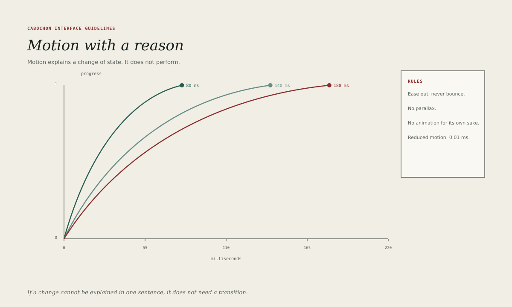

# Motion

Motion explains a change of state. It does not perform. A transition that
cannot be explained in one sentence does not need to exist.

## Durations

Cabochon uses three durations.

| Duration | Use                                            |
| -------- | ---------------------------------------------- |
| 80 ms    | A state change: hover, press, check, selection |
| 140 ms   | A pane reveal, a popover, a command palette    |
| 180 ms   | A window or sheet entering or leaving          |

The durations are ceilings, not targets. A transition that can complete sooner
should do so. Anything longer than 180 milliseconds belongs to a progress
indicator, not to a transition.

## Easing

All transitions use ease-out: fast at the start, settling at the end. The curve
is `cubic-bezier(0.2, 0.7, 0.3, 1)`. No bounce, no overshoot, no elastic, no
spring.

A transition that changes both position and opacity should animate opacity
slightly ahead of position, so that the surface is legible before it settles.

## What may animate

- The appearance and disappearance of a popover, menu or sheet.
- The expansion and collapse of a pane or disclosure.
- The change of a state chip from Refreshing to Current.
- The movement of a progress rule.
- The scroll position of a document when the user invokes a navigation
  command.

## What must not animate

- Text that is being read.
- A control the user is about to press.
- A layout that reflows while the user is typing.
- A window that the user has just closed and expects to be gone.
- Anything that runs continuously in the background.

A hover transition must not delay the hover state: the control changes
immediately and the transition only softens the change. A pressed control must
respond within one frame: one refresh interval, no more than 16.7 milliseconds
at 60 hertz.

## Progress

Progress is not a transition. A determinate progress rule advances with the
work and never runs backwards. An indeterminate rule moves at a constant speed
and does not imply completion. Neither uses a spinner when a rule will fit.

A refresh indicator may pulse gently while a background refresh is running, but
the pulse must stop when the refresh stops and must respect reduced motion.

## Reduced motion

When the system reports a preference for reduced motion, every transition
collapses to 0.01 milliseconds. Progress indicators become static rules with a
text label. No information may depend on motion; the state word and the colour
carry the meaning.

Reduced motion is a setting of the environment, not of an application. Every
Cabochon surface must honour it.

## Motion and state

A state change must be complete when the transition ends. If a chip fades from
Refreshing to Current, the word must change at the start of the fade, not at
the end, so that a user who looks away mid-transition still sees the truth.

## Testing motion

A reviewer should be able to answer three questions for every transition: what
changed, how long it took and what happens under reduced motion. A transition
that cannot answer all three is decoration, and should be removed.
