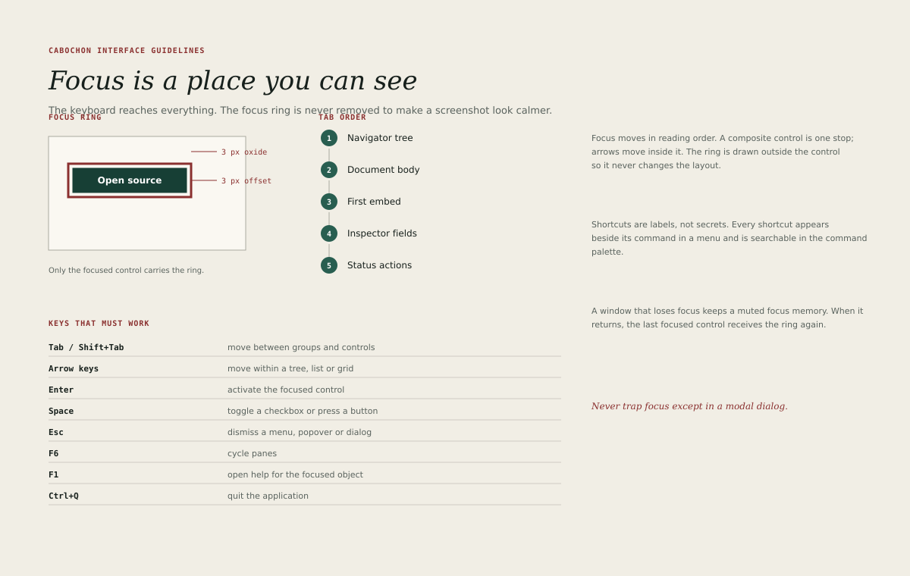

# Focus and keyboard

The keyboard must reach everything. A Cabochon surface that can only be
operated with a pointer is incomplete, and a focus ring that disappears to make
a screenshot look calmer is a defect.

## The focus ring

- Colour: the focus role. It resolves to oxide `#8A302F` in the light theme and
  to `#E0B36A` in the dark theme.
- Width: 3 units.
- Offset: 3 units outside the control's edge.
- Shape: follows the control's shape, square for a square control.
- Visibility: drawn for every focus source, including a pointer click.

The ring is drawn outside the control so that it never changes the layout. It
must remain visible on paper, high, control and dark grounds. Only one control
in a window carries the ring.

The ring is evaluated against the surfaces actually adjacent to it. A control
may sit on a pane of one luminance and against a neighbour of another, so the
ring carries a one-unit inner keyline in the ground role where the contrast
against either side would otherwise fall below 3:1. The ring is a decoration:
it has its own bounds, outside layout, and it is never clipped by the control's
border box.

## Tab order

Focus moves in reading order: left to right, top to bottom within the writing
direction of the interface.

A typical document window orders its stops as follows.

1. The navigator tree.
2. The splitter after the navigator, where one exists.
3. The document body.
4. The first embed or object in the document.
5. The splitter before the inspector, where one exists.
6. The inspector fields.
7. The status line actions.

A composite control is one tab stop. Arrow keys move within it: between the
items of a list, the cells of a grid, the options of a radio group or the tabs
of a tab bar. Tab moves out of the composite to the next stop.

## Keys that must work

| Key             | Action                                   |
| --------------- | ---------------------------------------- |
| Tab / Shift+Tab | Move between groups and controls         |
| Arrow keys      | Move within a tree, list or grid         |
| Enter           | Activate the focused control             |
| Space           | Toggle a checkbox or press a button      |
| Escape          | Dismiss a menu, popover, sheet or dialog |
| F6              | Cycle between panes                      |
| F1              | Open help for the focused object         |
| Control+Q       | Quit the application                     |

Instruments may add keys, but they may not rebind these. A shortcut must appear
beside its command in the menu and be searchable in the command palette; a
shortcut that exists only in documentation is a secret.

## Input modes and routing

A key means different things in different modes. The modes are declared, and
the routing order between them is fixed.

| Mode                 | What the keyboard acts on                                  |
| -------------------- | ---------------------------------------------------------- |
| Composition          | An input method's in-progress composition                  |
| Text editing         | The focused editable control's text and caret              |
| Composite navigation | The focused menu, tree, grid, tab bar or list              |
| Navigation           | The focused control, and the window's command shortcuts    |
| Modal dialog         | The dialog's controls; the document behind is inert        |
| Canvas tool          | The active tool's gesture and its declared commit boundary |

Routing priority, highest first:

1. An active input-method composition.
2. The focused editable control's text-editing commands.
3. The focused composite's local navigation and editing commands.
4. The window's document and view shortcuts.
5. Environment-wide shortcuts.

A key that is not consumed at one level falls to the next. A key that is
consumed is not also delivered to a lower level. The following table is the one
routing decision table; a chapter that describes a field, composite or surface
defers to it.

| Focus and state                    | Tab                                  | Enter or Return                                     | Escape                                           |
| ---------------------------------- | ------------------------------------ | --------------------------------------------------- | ------------------------------------------------ |
| Composition active                 | Consumed by the composition          | Consumed by the composition                         | Cancels the composition                          |
| Text field with completion         | Completes the highlighted completion | Accepts the highlighted completion                  | Dismisses the completion                         |
| Text field, no completion          | Leaves the field                     | Commits the field's own action, never the default   | Reverts the draft and leaves the innermost mode  |
| Composite in navigation            | Leaves the composite                 | Activates the focused item                          | Leaves the composite, then dismisses its surface |
| Focused button                     | Moves to the next stop               | Activates that button, even when it is destructive  | Dismisses the surface without acting             |
| Navigation, no activatable control | Moves to the next stop               | Activates the surface's default, if it has one      | Dismisses the surface                            |
| Canvas tool, no text field         | Moves to the next chrome stop        | Commits the pending gesture; otherwise not consumed | Cancels the pending gesture                      |
| Modal surface                      | Cycles within the surface            | Follows the focused-control rows above              | Performs the surface's declared safe exit        |

**Enter and Return are the same activation event.** The default action is not a
global key handler that overrides focus: it applies only when no activatable
control has focus and focus is not in a text field or a composite that consumes
the key. A destructive button is never the default, but when it is deliberately
focused, Enter or Return activates it. Space presses a button or toggles a
checkbox in navigation mode and types a space in a text field.

Inside a grid, Tab commits the cell edit and moves right only while the grid is
in cell-edit mode; Escape leaves cell-edit mode, and the next Tab leaves the
grid. A grid never cycles Tab indefinitely without an escape. A completion list
consumes Up, Down, Enter and Escape while it is open. Tab completes only when a
completion is offered; otherwise it leaves the field. A canvas tool's
single-letter shortcuts apply only while the canvas has focus and no text field
is active.

Escape cancels the innermost mode in this order: composition, completion, cell
edit or text draft, transient surface, tool. Dismissing a completion leaves the
draft text and its edit history intact; the next Escape reverts the draft and
leaves the mode. Escape never commits a draft. Every surface dismissal,
including a menu, a popover, a palette and a dialog, returns focus through the
focus-return chain below.

Every composite declares its exit. A menu closes on Escape and on Left or
Right; a tree leaves on Tab; a grid leaves on Tab in navigation mode; a tab bar
leaves on Tab; a canvas tool leaves on Escape or on switching tools. A
composite with no declared exit is a defect.

## Focus memory and the focus-return chain

A window that loses focus remembers its last focused control. When the window
returns, that control receives the ring again. The remembered control is shown
with a muted ring while the window is inactive, so that the user can see where
focus will land.

When a surface closes, focus returns through a chain, not to a single assumed
control.

1. The original invoker, if it still exists and is operable.
2. The surviving logical context that contained it: the same pane, object or
   document region.
3. An explicit safe fallback: the document body, then the window's first
   operable control.

The chain is preserved when one transient surface launches another. A command
palette that opens a dialog records the palette's own invoker, so closing the
dialog and then the palette returns to the control that opened the palette, not
to a result row that no longer exists.

A pane that is collapsed and reopened restores the focus of its last active
control only when the reopening action requests focus. Background layout
restoration, a project reopening or a window resize does not steal focus from
an unrelated edit. Selection retention is not focus restoration: a pane may
remember what was selected without taking the keyboard.

## Trapping and escaping

Focus is trapped only in a modal surface. Every other surface must allow the
user to leave with Tab, Shift+Tab or Escape.

A popover that contains a text field must close on Escape without submitting. A
command palette must close on Escape and return focus through the focus-return
chain. A modal dialog must return focus through the same chain when it closes,
whether the user confirmed or cancelled.

A disabled control is not a trap. It leaves the tab order, and its reason
remains reachable through the associated help text, the menu item that mirrors
it, or the command palette. A disabled menu item stays in the menu's roving
navigation so that its reason can be read without activating it.

## Access keys

Menu labels may carry an access key, shown with an underline. Access keys are
activated with Alt and are localized with the interface. They are a convenience
for pointer-averse users, not a substitute for the full keyboard path.

## Focus and selection

Focus and selection are different. Focus says where the keyboard will act;
selection says what the next command will affect. A focused row is not
necessarily selected, and a selected row may be outside the focus.

The interface must show both. A selected row in an inactive pane becomes a
pine-2 outline with an ink label; the fill is reserved for the active pane. A
focused row in an active pane carries the ring. A command that acts on the
selection must remain enabled while the document has focus, even if the
selection was made in another pane.

## Testing

A reviewer can test keyboard access without a pointer: open the application,
press Tab repeatedly, and confirm that every enabled control is reachable, that
the ring is always visible, that no control traps focus outside a modal
surface, and that Escape returns the user to the document.

The test is repeated in each input mode. A reviewer enters a grid, edits a
cell, opens a completion list, opens a dialog from the palette and cancels a
canvas tool, confirming each time that the intended level consumed the key,
that the composite could be left, and that focus returned through the declared
chain. Disabled controls are checked separately: their reason is discoverable
without activation, and no disabled control is counted as a missing tab stop.

`make keyboard` runs the ordered Escape fixtures in
`tools/keyboard-fixtures.json`. In the central fixture a text field holds an
edited draft and an open completion: the first Escape dismisses the completion,
leaves the draft text and its dirty flag intact, and keeps focus in the field;
only the second Escape reverts the draft.
