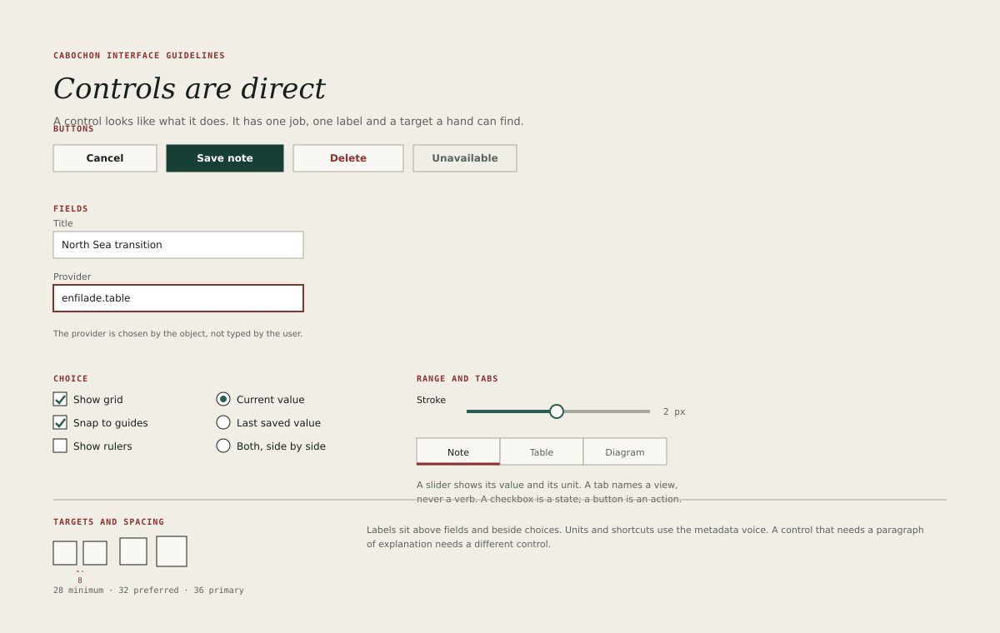

# Controls

A Cabochon control looks like what it does. It has one job, one label and a
target a hand can find. The shared gallery is small on purpose; an instrument
that needs a new control should add it here before using it.

## Buttons

A button performs an action. Its label is a verb phrase in sentence case:
**Save note**, **Export plate**, **Replace**.

| Variant     | Fill          | Text  | Use                                  |
| ----------- | ------------- | ----- | ------------------------------------ |
| Standard    | Control plane | Ink   | The ordinary action in a group       |
| Primary     | Pine 2        | White | The one expected action in a surface |
| Destructive | Oxide         | White | An action that removes or replaces   |
| Disabled    | Control plane | Soft  | An action that is not available      |

- A surface has at most one primary button.
- A destructive button appears only in a confirmation or in a menu, never as
  the default action of a routine form.
- A disabled button remains visible and explains why it is unavailable in a
  tooltip and to assistive technology.
- Button heights are 28 pixels minimum and 32 preferred. A dialog button is 32
  pixels minimum; a primary action in a dialog is 36.

## Fields

A field accepts text. Its label sits above the field, left-aligned to the
field's edge, in 12-pixel interface type. A unit or a format hint sits to the
right of the field or inside it as placeholder metadata, never as the only
label.

- A field's border is 1 pixel in line. On focus it gains the 3-pixel oxide
  ring instead of a thicker border.
- A read-only field keeps the pane fill and uses soft text; it must not look
  disabled if its value can still be selected and copied.
- A field that accepts a typed identity, such as a provider name, must
  validate on commit and show the error beside the field, not in a dialog.
- Password fields are not used in the first batch. A capability is granted
  through a host portal, not typed into an application.

## Choice controls

A checkbox is a state that the user can turn on or off. A radio group is a
choice among mutually exclusive options. A toggle is a checkbox drawn as a
switch and is reserved for an immediate setting, such as a pane's visibility.

- Checkbox labels describe the state when checked: **Show grid**, not **Grid**.
- Radio groups carry a group label and list every option, even when one is
  unavailable.
- A radio group never starts with nothing selected unless the object genuinely
  has no value; in that case the group shows an explicit **None** option.
- Choice controls are 28-pixel targets, with the box or dot aligned to the
  first line of the label.

## Sliders and steppers

A slider is for an approximate value with a visible range. A stepper is for an
exact value with a small range. Neither replaces a field when the exact value
matters.

A slider must show its current value and its unit at all times, not only while
dragging. Its track is 4 pixels high; its thumb is an 8-pixel circle with a
2-pixel pine border. The keyboard changes the value by one step with an arrow
and by ten steps with Page Up and Page Down.

## Tabs

A tab names a view, never a verb. **Note**, **Table** and **Diagram** are tabs;
**Insert** and **Export** are not.

- The active tab carries a 3-pixel oxide rule along its bottom edge.
- Tabs are 32 pixels high and at least 100 pixels wide when labels allow.
- A tab bar with more than seven tabs should become a list or a pane.
- Tabs are one tab stop; arrow keys move between them.

## Menus and popovers

A menu is a list of commands; a popover is a small surface anchored to a
control. Both use the overlay plane, the 1.5-pixel border and the offset shadow
from [Planes and borders](15-planes-borders.md).

A popover must close when the user clicks outside it or presses Escape. It must
not contain a second popover. If a task needs two levels, it needs a dialog or
a pane.

## Labels and help

- Every control has a visible label or an accessible name from the shared
  vocabulary.
- A control that needs a paragraph of explanation needs a different control.
- Help text sits below the control in 11-pixel metadata and is associated with
  the control for assistive technology.
- Units are metadata, placed consistently: pixels in a drawing tool, points in
  a page tool, currency codes in a value.

## Sizes and spacing

Controls sit on the 4-pixel grid. Related controls are 8 pixels apart; groups
are 12 or 16 pixels apart. A row of buttons aligns on the baseline of its
labels and uses equal heights. The primary button may be taller only when it
sits alone as the main action of a dialog.

## What not to build

- A button that opens a menu on hover.
- A field that submits on every keystroke without saying so.
- A checkbox that performs an irreversible action immediately.
- A slider without a value.
- A tab that changes the document without a transaction.
- A custom control that duplicates a shared one with a different height.
