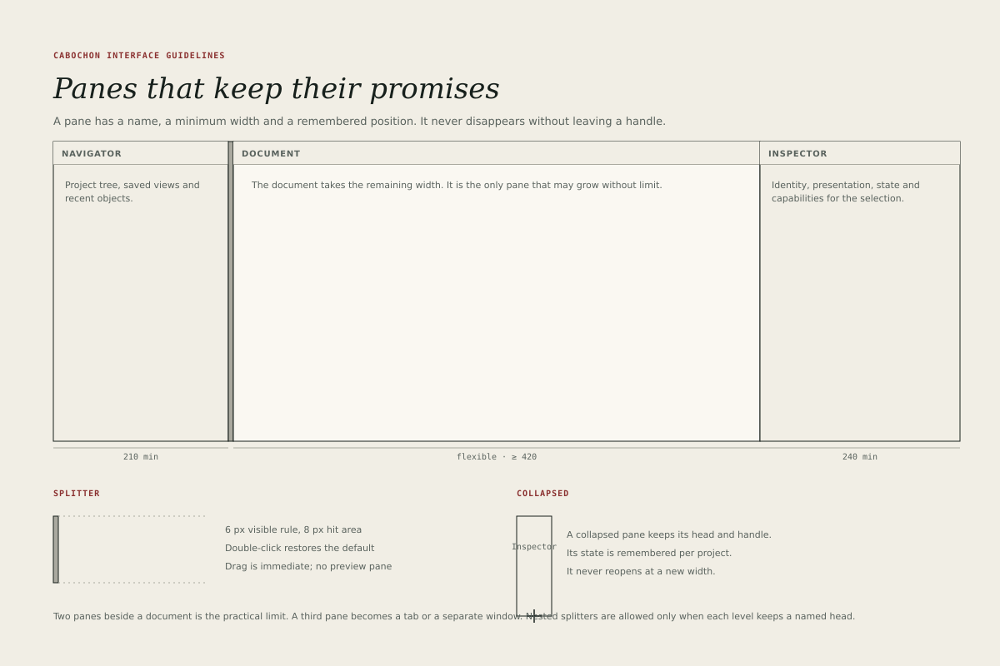

# Panes

A pane is a region of work with a name, a minimum width and a remembered
position. It never disappears without leaving a handle, and it never reopens at
a different width than the one the user chose.

## The three-pane window

The standard document window has a navigator, a document and an inspector.

| Pane      | Minimum width | Behaviour                                |
| --------- | ------------- | ---------------------------------------- |
| Navigator | 210 px        | Collapsible; remembers width per project |
| Document  | 420 px        | Flexible; takes the remaining width      |
| Inspector | 240 px        | Collapsible; remembers width per project |

The document is the only pane that may grow without limit. The navigator and
inspector keep their widths when the window grows, so that the document gains
the space.

An instrument without a navigator may use a two-pane layout. An instrument
without an inspector may use a single document plane. No instrument uses more
than two side panes beside the document; a third becomes a tab or a separate
window.

## Pane heads

Every pane carries a 28-pixel head with its name in 12-pixel interface type,
left-aligned to the 16-pixel content inset. A head may carry one trailing
action, such as **Add** or **Filter**, drawn as a 20-pixel icon with a 28-pixel
target.

A pane head is not a toolbar. If it needs more than one action, those actions
belong in the pane's context menu or in the main menu bar.

## Splitters

- Visible rule: 6 pixels wide in the line colour.
- Hit area: 8 pixels wide, centred on the rule.
- Cursor: horizontal resize over the splitter.
- Drag: immediate, with no preview pane and no snapping unless the user holds
  a modifier.
- Double-click: restores the pane's default width.
- Keyboard: the splitter is a tab stop; use the arrow keys to resize by 8
  pixels, or Shift with an arrow to resize by 32.

A splitter must not move a pane below its minimum width. When the window is too
narrow for the minimums, the inspector collapses first, then the navigator, and
the document keeps its 420-pixel minimum.

## Collapse and restore

A collapsed pane keeps its head and a 42-pixel handle showing its name
vertically. It does not vanish into an unlabelled edge.

- Collapse state and width are stored per project, not per application
  session.
- Reopening a project restores the layout the user left.
- A pane that reopens after a window resize returns to its remembered width,
  clamped to the new minimum.
- A pane must be reachable from the **View** menu and from the command
  palette, not only by dragging.

## Nested splits

Nested splitters are allowed only when each level keeps a named head. A
vertical split inside a navigator, for example, may hold a project tree above
and a list of saved views below, each with its own head. Without heads, the
nesting is ambiguous and the user cannot tell which region a drag will resize.

## Scrollbars

Panes scroll independently. A scrollbar is 12 pixels wide, with a 6-pixel thumb
and no arrow buttons. It appears on hover or when the content overflows, and it
remains visible while the pointer is over the pane. Scroll position is
remembered per pane and per document.

## Empty panes

An empty pane is not a blank rectangle. It names its purpose and offers the
action that fills it: **No saved views. Save the current view.** A pane that is
empty because its source is unavailable shows the corresponding live state, not
an empty-state illustration.

## Pane focus

F6 cycles through panes in spatial order. The focused pane's head gains a
2-pixel oxide underline, and the last focused control inside the pane receives
the focus ring. A pane that contains no focusable control receives the ring on
its head, which then responds to the keyboard's context-menu key.
