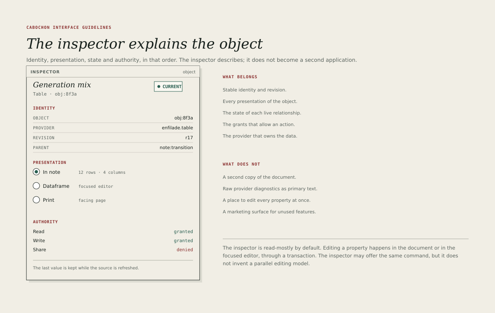

# Inspector

The inspector explains the object under the selection. It answers four
questions in a fixed order: what the object is, how it is being shown, what
state its relationships are in and what the application is allowed to do with
it.

The inspector describes. It does not become a second application, and it does
not become the place where every property is edited.

## Structure

The inspector is 240 pixels wide by default and uses the pane plane. Its head
carries the word **Inspector** and, where useful, the selected object's type.

The body is divided into four blocks.

1. **Identity.** Object identity, provider, revision and parent.
2. **Presentation.** Every presentation of the object, with the current one
   selected.
3. **Authority.** The capabilities that allow read, write, share and export.
4. **State.** The live relationship state and its last successful update.

A fifth block for instrument-specific properties may follow, but it must not
push identity below the fold.

## Identity block

The identity block shows:

- the object's display name, in 18-pixel display italic;
- its type and a short identity suffix, in 11-pixel metadata;
- its provider;
- its revision;
- its parent object or document.

Each value is selectable and copyable. A command copies the full identity, not
the displayed suffix. The inspector must never show a file path in place of an
identity.

## Presentation block

Every presentation of the object is listed, with the current presentation
marked. Choosing another presentation changes the view, not the object.

- The list names the presentation and its context: **In note**, **Dataframe**,
  **Print**.
- A presentation that is unavailable is shown greyed with a reason.
- The block does not offer to convert, flatten or export unless the object
  genuinely supports that operation.

## Authority block

The authority block lists the capabilities relevant to the selection and
whether each is granted, denied or not requested.

- Granted appears in pine 2.
- Denied appears in oxide and names the capability in plain language.
- Not requested appears in soft text.

A denied capability must not reveal the protected value anywhere in the
inspector, including in a tooltip, a count or a revision number that could leak
activity.

## State block

The state block shows the live relationship state using the vocabulary of
[Live relationships](08-live-relationships.md). It includes the last successful
refresh time in metadata and the action that can restore the relationship.

The state block is the one place where the inspector may show a provider's
diagnostic text. It must be a sentence, not a stack trace, and it must be
paired with a user action.

## Read-mostly by default

The inspector may edit a property, but editing happens through the same
transaction as the document. It must not maintain a parallel copy of the object
or a private undo stack.

The rule has three consequences.

- A property change made in the inspector is undoable with the document's undo.
- The inspector shows the object's current revision, not a draft.
- A conflict in the inspector is resolved with the same conflict surface as a
  conflict in the document.

## What the inspector is not

- A second copy of the document.
- A raw diagnostic console.
- A place to edit every property at once.
- A marketing surface for unused features.
- A substitute for a focused editor.

## Empty and multiple selections

With no selection, the inspector shows the document's identity and state. With
multiple objects selected, it shows the shared properties and a count, and
every property that differs reads **Mixed**. Editing a mixed property applies
the new value to every selected object through one transaction, and the
inspector says so before the change is committed.

## Width and scrolling

The inspector scrolls vertically, never horizontally. Its labels truncate at
the end and reveal the full value in a tooltip. A user may widen it by dragging
the splitter, up to 360 pixels; beyond that, the content should move to a
dedicated pane.
