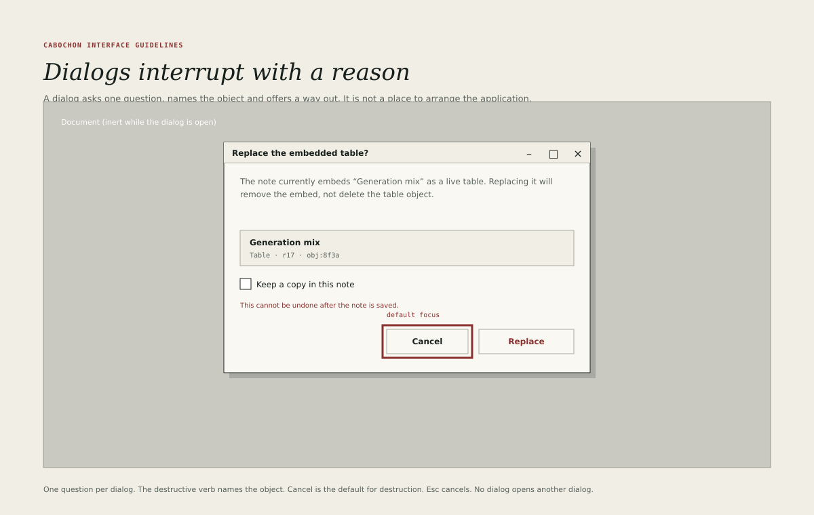

# Dialogs

A dialog interrupts the user's work, so it must earn the interruption. It asks
one question, names the object concerned and offers a clear way out. It is not
a place to arrange the application, explain the product or collect unrelated
settings.

## When to use a dialog

Use a dialog when all three statements hold.

1. The decision cannot be deferred.
2. The decision needs information that the document does not show.
3. Proceeding without the decision would lose work or authority.

When any statement fails, use a sheet, a popover, an inline message or a status
line instead. A routine, reversible operation must not open a dialog.

## Anatomy

A Cabochon dialog has five parts.

- A title bar naming the question, such as **Replace the embedded table?**
- A sentence or short paragraph explaining the consequence.
- An identity block naming the affected object, with its type, revision and
  identity suffix.
- Optional choices, such as **Keep a copy in this note**.
- Actions at the bottom right: a safe action and the confirming action.

The dialog uses the overlay plane and the offset shadow. Its width is between
420 and 560 pixels; a dialog that needs more should become a sheet or a pane.

## Wording

- The title asks one question, in sentence case, ending with a question mark
  when it is a question.
- The body names the object and states the consequence in plain language.
- The confirming button uses the specific verb: **Replace**, **Delete**,
  **Discard**, **Remove embed**.
- The safe button is **Cancel**, not **No**, **Dismiss** or **Close**.
- A destructive consequence is stated once, in the body. It is not repeated in
  three places.

## Defaults and focus

For a destructive dialog, focus starts on **Cancel**. The destructive button is
never the default action of the Return key.

For a non-destructive dialog, focus may start on the primary action when the
dialog is a confirmation of an action the user has just requested. Even then,
Escape must cancel without side effects.

The focus ring is drawn on the focused button, as described in
[Focus and keyboard](18-focus-keyboard.md).

## Behaviour

- Escape cancels the dialog.
- Return activates the default action.
- Tab cycles within the dialog; focus does not escape to the document behind.
- The document behind is inert and visibly dimmed, but remains readable.
- Closing the dialog returns focus to the control that opened it.
- A dialog must not open another dialog. If a second question is required, the
  first dialog closes and the second takes its place, or the questions are
  combined.
- A dialog must not be resizable unless it contains a scrollable list of
  objects selected by the user.

## Destructive actions

A destructive action removes, replaces or overwrites something the user can
see. The dialog must state:

- what will be removed or replaced;
- what will remain;
- whether the action can be undone;
- the object's identity, where more than one similar object exists.

The dialog must not use a red heading for a non-destructive action, and must
not use a neutral button for a destructive one. Colour supports the verb; it
does not replace it.

## Progress and long operations

A dialog must not remain open while a long operation runs behind it. Close the
dialog, show progress in the status line and the document, and report the
outcome once. If the operation fails, the failure appears in the document with
a recovery action, not in a second dialog stacked on the first.

## Sheets and host dialogs

Where the host supports sheets, a document-modal dialog attaches to its window
as a sheet. Where it does not, the dialog is centred over the window. In hosted
mode, file, print and portal dialogs belong to the host and must not be
imitated by the application.

## Testing

A reviewer should be able to cancel every dialog with Escape, confirm the safe
default with Return, and return to the exact control that opened it. A dialog
that fails any of these tests is not ready.
