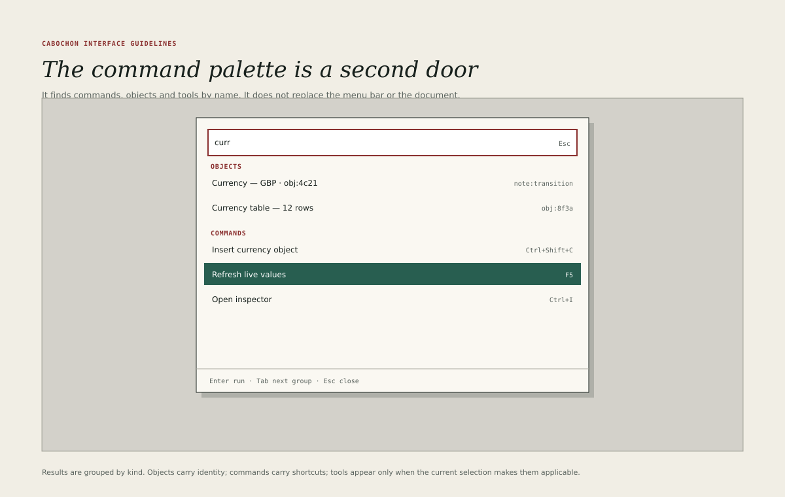

# Command palette

The command palette finds commands, objects and tools by name. It is a second
door to the same rooms, not a replacement for the menu bar, the tool strip or
the document.

## Opening and closing

- The palette opens with Control+K from anywhere in the application.
- It closes with Escape, returning focus to the control that opened it.
- It opens over the document, centred horizontally and 80 pixels from the top
  of the document plane.
- It never opens as a separate window and never appears in the window list.

## What it searches

The palette searches four kinds of result, in this order.

1. **Commands** — every menu command, including those in the instrument's own
   menus.
2. **Objects** — documents, notes, dataframes, diagrams and bitmaps in the
   current project, by name and by identity suffix.
3. **Tools** — tools applicable to the current selection, by name and by
   provider.
4. **Places** — saved views, panes and recent documents.

The order is a default, not a straitjacket: a query that matches an object
exactly should put that object first. The palette must never hide a command
because the instrument considers it rare.

## Result rows

Each row carries:

- the result's name, in 12-pixel interface type;
- its kind, in 11-pixel metadata;
- its shortcut, right-aligned, when it has one;
- its source or provider, when the result is an object or a tool.

A command that is currently unavailable appears greyed with the reason. A
command that is destructive appears with its destructive mark and never becomes
the default result of an empty query.

## Disclosure

The palette is a search surface, so it obeys the metadata disclosure policy in
[Live relationships](08-live-relationships.md) as strictly as the document does.

- An object the user may not inspect is omitted from the results. It is not
  shown as a greyed row, a placeholder or a count.
- A result's name, identity suffix, provider and source chip are separate
  metadata classes. Each is withheld when the current grant protects it, and
  the row remains usable only if enough of it is disclosable to identify the
  result.
- The palette must not reveal a protected object's existence through result
  ordering, an empty-query count or a "no results" message that distinguishes
  "none" from "none you may see".
- A recent-command list contains commands, not objects, so it is not a
  disclosure channel. A recent-object list would be, and the first batch does
  not provide one.
- A diagnostic or error surfaced from a result follows the same policy: it
  names the failure, not a protected object's identity or revision.

## Query behaviour

- Matching is case-insensitive and ignores diacritics.
- Space-separated words match in any order.
- A leading `>` restricts the search to commands.
- A leading `@` restricts the search to objects.
- A leading `#` restricts the search to tools.
- The palette remembers the last ten commands and shows them when the query is
  empty, below a **Recent** heading.
- The palette must not search document content in the first batch. Content
  search belongs to the project window, where results can be reviewed in
  context.

## Keyboard

| Key       | Action                                  |
| --------- | --------------------------------------- |
| Up / Down | Move the selection                      |
| Enter     | Invoke the selected result              |
| Escape    | Close without invoking                  |
| Tab       | Complete the current word, where useful |
| Control+K | Close, when the palette is already open |

The palette is one tab stop. The field keeps focus while the arrow keys move
the result selection. The result list is exposed to assistive technology as a
listbox with an active option.

## Running a command

If the selected command needs no further input, the palette closes and the
command runs. If it needs input, the palette closes and the command's own
surface opens, with the query carried into its first field where that is
sensible.

The palette must not run a command in the background while remaining open, and
it must not keep a command's progress inside itself. Progress belongs to the
status line and the document.

## What the palette is not

- A settings browser. Settings live in the relevant pane or dialog.
- A file browser. Use the project window or the host's file portal.
- A replacement for menus. Every command in the palette is also in a menu.
- A command-line shell. The first batch does not expose a scripting prompt
  through the palette.

## Empty and error states

An empty query shows recent commands and a one-line hint: **Type a command,
object or tool.** A query with no results says so once and suggests removing a
filter. The palette must not show an error dialog when a command fails; it
closes and reports the failure in the document, like any other command.
