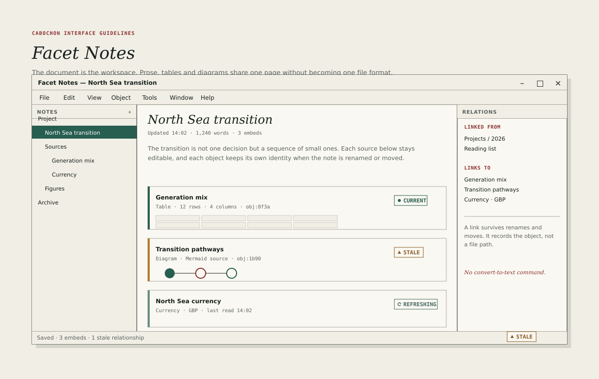

# Facet Notes

Facet Notes is the workspace's writing instrument. Its document is a note: a
sequence of prose blocks, embedded objects and links. The note is the
workspace, and the objects inside it remain themselves.

## Layout

Facet Notes uses a three-pane window.

- A 210-pixel note tree on the left, showing the project's notes by folder.
- A flexible document plane in the centre, measuring 60 to 75 characters per
  line at the default width.
- A 220-pixel relations panel on the right, showing links from and to the
  note.

Either side pane may be collapsed, and the layout is remembered per project.
The document keeps its 420-pixel minimum.

## The note tree

The tree shows notes and folders, not files. A note's name is its title, and
renaming it does not change its identity.

- Rows are 28 pixels high with 16-pixel indentation per depth.
- The selected row uses the pine-2 fill with white text.
- A note with an unresolved link carries a small oxide dot; a note with a
  stale embed carries an amber dot.
- The tree's **Add** action creates a note, not a folder, unless the user
  chooses otherwise from its menu.
- Dragging a note moves it in the tree and updates its parent, but never
  breaks an inbound link.

## The document plane

The note's title is a display-italic heading, 24 pixels, editable in place.
Below it, a metadata line records the last update, the word count and the
number of embeds.

Prose uses 15- or 16-pixel body type with a 1.6 line height. Paragraphs are
separated by 16 pixels. Headings within the note use the section voice at 18 or
20 pixels. Inline code and object identities use the metadata voice.

The note must support:

- headings, paragraphs, lists, quotes and code blocks;
- inline links to other notes and objects;
- embedded objects as blocks, with their own state;
- a source view for the underlying Markdown, reachable from the **View**
  menu.

## Embeds in a note

An embedded object is a block, not an image. It occupies the full measure of
the note and carries:

- a 4-pixel state edge on its leading side, in the colour of its relationship
  state;
- the object's name in 12-pixel interface bold;
- its type, size and identity suffix in 11-pixel metadata;
- a state chip at the trailing edge;
- a compact presentation of its content.

The state edge is the only persistent colour in the document plane. A current
embed uses pine 2, a refreshing embed uses teal, a stale embed uses amber, and
a broken or denied embed uses oxide. The chip carries the word.

Selecting an embed shows a 2-pixel oxide outline and a small action bar with
**Open**, **Change presentation** and **Inspect**. The action bar must not
obscure the object's content.

## Links and relations

A link records an object, not a file path. It survives a rename, a move and an
export.

- An internal link is drawn in pine 2 with a dotted underline.
- A link to a missing object is drawn in oxide with a dotted underline and
  offers **Create** or **Unlink**.
- The relations panel lists inbound and outbound links by name, grouped under
  **Linked from** and **Links to**.
- Backlinks are computed, not stored in the note's text, so that they cannot
  drift.

## Saving

Facet Notes saves continuously and visibly. The title bar shows a modified
bullet while a change is pending, and the status line records the last save
time. A save failure keeps the document open, marks it modified and offers a
retry.

The note must never close with unsaved changes without a dialog that names the
note and offers **Save**, **Discard** and **Cancel**. **Cancel** is the safe
default, so that an accidental Return keeps the note open; **Save** remains the
primary action.

If the close follows a failed save, the dialog offers **Keep open**, **Export
copy** and **Discard**. **Keep open** is the default; **Export copy** is the
primary action, because it is the only action that both preserves the work and
lets the user leave. None of the three pretends that the save can succeed.

## What the note is not

- A file that contains rendered copies of its embeds.
- A rich-text format that hides its source.
- A place where an object can be converted to text by a single command.
- A database view. Queries belong to the project window or the Enfilade Table.

## Testing

A reviewer should rename a note, move it to another folder, reopen the project,
and confirm that every inbound link still resolves and every embed keeps its
identity, presentation and state.
