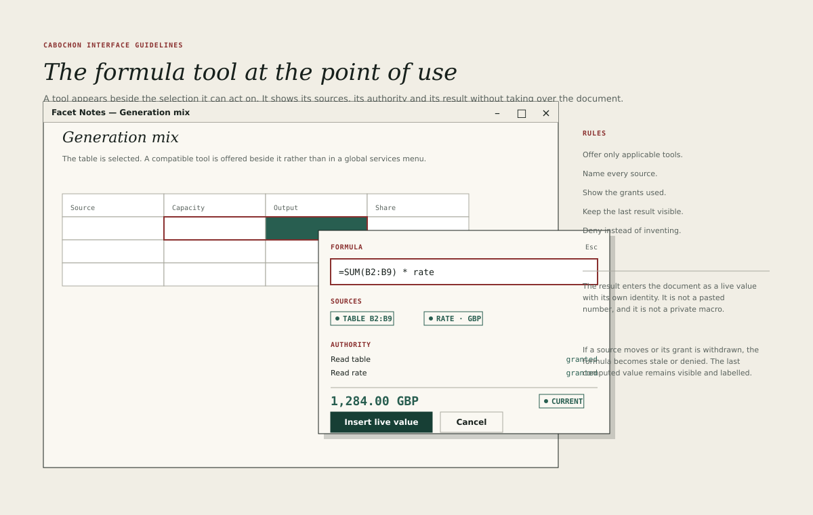

# The formula tool

The formula tool is Cabochon's proof that a tool can act across object types
without ambient authority. It appears beside a compatible selection, names what
it will read, shows what it is allowed to do and returns a live value with its
own identity.

## Where it appears

The tool is offered when the selection exposes an addressable scalar selector
and the application holds the capabilities the tool requires.

- A numeric cell in a dataframe.
- A currency value.
- An addressable note entity, such as a defined term.
- A diagram element with a declared value.

An incompatible selection does not show the tool. It is not greyed in a global
services menu, because the environment does not have one.

## The popover

The formula popover is anchored to the selection. It is 430 units wide and
contains:

- a **Formula** kicker and an Escape hint;
- an expression field, focused, with the current expression selected;
- a **Sources** block listing every object and selector the expression reads;
- an **Authority** block listing the capabilities used and their outcome;
- the computed result at 18 units in the interface voice bold, using the
  section size for a previewed value rather than for a heading, with its state
  chip;
- **Insert live value** as the primary action and **Cancel** as the way out.

The popover must not cover the selected cells. It flips above or beside the
selection as space allows.

## Sources

Every source is named explicitly.

- A source chip carries the object's name and the selector, such as
  **TABLE B2:B9** or **RATE · GBP**.
- Selecting a source chip reveals the object in its own instrument without
  closing the popover.
- A source that is stale or broken is marked on its chip with the same state
  vocabulary as the rest of the environment.
- The expression may not read a source that is not listed. If the user types
  an undeclared reference, the tool offers to add it before evaluating.

A visible address is resolved to a stable typed selector before evaluation. The
expression must declare whether it uses positional semantics or entity
semantics:

- A **positional** selector denotes whatever occupies the displayed address at
  evaluation time. Sorting, filtering or inserting rows changes what it reads,
  and the interface says so when the expression is created.
- An **entity** selector denotes the identified rows, columns or diagram
  elements. Sorting, filtering and insertion do not change its referents; a
  deleted referent becomes a recoverable broken reference rather than silently
  attaching to the next row or node.

The selector kind is part of the expression, not a hidden property of the
editor. The default for a new expression is entity semantics for object
references and positional semantics for a literal address range, and the
popover shows which was chosen.

A source inspection that leaves the popover suspends it rather than dismissing
it. The popover remains pinned to the captured invocation context, and the
returning user sees the same selection and operation.

## Authority

The authority block shows each capability the expression needs and whether the
runtime's capability broker granted it for this invocation.

- **Granted** appears in the pine role.
- **Denied** appears in the oxide role and names the capability in plain
  language.
- A denied read must not reveal the value, not even as a partially computed
  result, a shape, a row count or a timing.
- The tool must not request a broader capability than the expression uses.

The grant that authorises the preview is scoped to the invocation. It permits
the computation the user is about to see and the insertion that follows, and
the tool does not retain it after the popover closes. The broker, not the
provider, issues, scopes, delegates and revokes grants. A provider validates
its own payload and produces revisions; it cannot widen a grant.

Preview authority and object authority are different. An inserted value
receives its own delegated grant, recorded with its identity, which the broker
may revoke at any time. The interface must never imply that insertion preserves
the popover's grant.

## The result

The result is computed before insertion, so that the user can see what will
enter the document. It uses the result's declared type and format.

- A currency result shows its currency code.
- A number result shows its unit and precision.
- A result that is still computing shows **Refreshing** and, when authority
  permits, the last accepted value.
- A result that cannot be computed shows the state and the reason, with
  **Insert live value** disabled.

The result must never be a value that the authority block does not justify. A
draft expression that does not parse leaves the last committed result intact
and shows a draft error beside the field; it does not turn the committed result
into a fresh computation.

## Inserting

**Insert live value** inserts a live value object into the document at the
captured selection, or into the captured note at the captured caret.

The destination, the caret or selection, the source identities and the
authority decision are captured when the popover opens. If any of them changes
before insertion, the tool revalidates them at commit. It either inserts into
the still-valid captured destination or asks the user to resolve the change; it
never retargets silently to the new selection.

Insertion is one atomic operation: the runtime creates the result, establishes
its authorised dependency and inserts the reference, or none of the three
happens. A failure leaves no orphaned half-result, no dangling reference and no
retained grant.

- The inserted value records the expression, its sources and the capabilities
  it needs.
- Those capabilities are delegated to the new object, not borrowed from the
  popover. The object may refresh only while the broker grants them; a refusal
  or expiry moves it to **Denied** immediately.
- It has its own identity and can be inspected, refreshed and exported.
- It is not a pasted number.
- It is not a private macro that only this application can evaluate.

Editing an inserted value's expression updates that same object and commits a
new content revision. It does not allocate a fresh identity. Cancelling the
edit preserves the committed expression, result and identity.

If the document does not accept a live value at the caret, the primary action
becomes **Copy result** and the reason is stated.

## Failure and recovery

- If the source reports a newer revision, the value becomes **Stale** and keeps
  its last result.
- If the grant is withdrawn or expires, the value becomes **Denied** immediately
  and hides its result, even if a refresh is in flight.
- If the provider crashes or its transport is lost, the value becomes
  **Broken** without waiting for a refresh, and offers **Retry**.
- If the provider moves without changing its revision, the relationship
  re-resolves and remains **Current**. A move of location is not, by itself, a
  stale value.
- A late reply from an older request cannot overwrite a newer result or
  reverse a denial.
- Recovery moves the value to **Refreshing** and then **Current** without a
  modal dialog and without changing its identity.

## Keyboard

| Key           | Action                                                                                |
| ------------- | ------------------------------------------------------------------------------------- |
| Enter         | Insert the live value when the expression field has focus and composition is complete |
| Escape        | Dismiss a completion, then cancel and restore the selection                           |
| Control+Space | Offer selector completions                                                            |
| Tab           | Move between expression, sources and actions                                          |

The expression field supports the usual editing keys and must not swallow Tab,
so that the user can reach the actions without a pointer. Enter while another
control has focus activates that control; it does not insert the value. While
an input-method composition is active, Enter commits the composition first. The
input-mode rules are those of [Focus and keyboard](18-focus-keyboard.md).

A selector completion lives inside the expression field and never traps focus.
The first Escape dismisses an open completion and leaves the expression
unchanged; only a second Escape cancels the operation. Arrow keys move within
the completion list while it is open, and the list closes without invoking
anything when focus leaves the field.

## What the tool is not

- A global calculator.
- A scripting console.
- A way to read a value the application was not granted.
- A converter that flattens a live result into text on insertion.
- A service menu that lists tools the selection cannot use.
