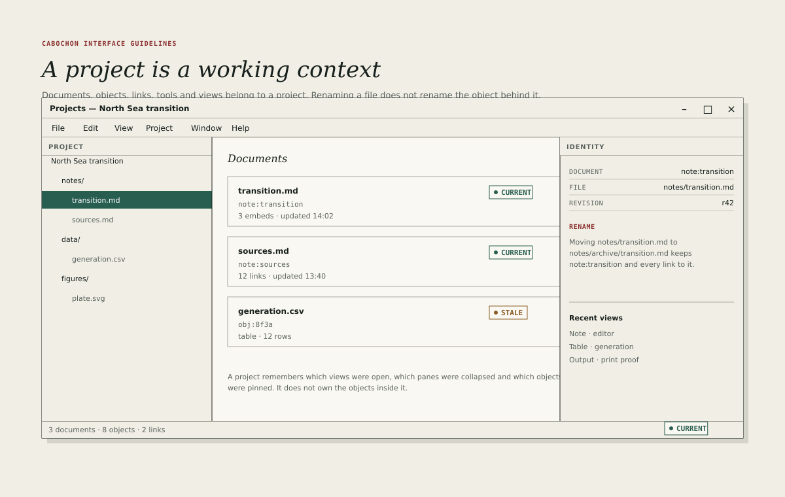

# Projects

A project is a working context. It gathers documents, objects, links, tools and
saved views so that a person can return to a piece of work. It does not own the
objects inside it, and it does not define their identity.

## The project window

The project window has three regions.

- A 260-pixel project tree on the left, showing notes, data and figures.
- A flexible document list in the centre, showing the project's documents
  with their identities, details and states.
- A 280-pixel identity panel on the right, explaining the selected document.

The window's status line reports the number of documents, objects and links.
The identity panel is read-only except for renaming and pinning; editing
belongs to the document's own instrument.

## The tree

The tree shows a working arrangement, not necessarily a directory listing. A
project may present folders, virtual collections and pinned items in one tree.

- Rows are 28 pixels high with 16-pixel indentation.
- The selected row uses pine 2 with white text.
- A document with a stale relationship carries an amber dot; an unresolved
  link carries an oxide dot.
- Dragging changes the working arrangement without changing object identity.
- A folder is a view over objects, not a container that owns them.

A project may be stored as a file or as a directory. The interface must not
imply that moving a document in the tree moves a file on disk unless the
project is explicitly file-backed.

## The document list

Each document row shows:

- its name, in 13-pixel interface bold;
- its identity, in 11-pixel metadata;
- a short detail, such as "3 embeds · updated 14:02";
- its live state chip.

A row opens the document in its instrument. A secondary action opens it in a
new window, reveals it in the tree or copies its identity. The list sorts by
name, update time or state; the sort is remembered per project.

## Identity and rename

The identity panel explains the difference between a document's name and its
identity.

- **Document** shows the object identity, such as `note:transition`.
- **File** shows the path, when the project is file-backed.
- **Revision** shows the current revision.
- A rename changes the name and, for a file-backed project, the path. It does
  not change the identity or break inbound links.

The panel must state this in one sentence, because it is the fact users most
often doubt. The figure's example renames a note into an archive folder and
keeps both its identity and its links.

## Views

A project remembers views, not just documents.

- Open documents and their window positions.
- Collapsed panes and their widths.
- The project tree's expansion and selection.
- The document list's sort and filter.
- Recent views, listed in the identity panel.

A view is a presentation of the working context. It must not be confused with a
saved document, and it must not be exported as one.

## Pinning

Pinning keeps an object or a view at the top of the project tree or the recent
list. A pinned item is a convenience, not a capability; unpinning never removes
the object.

## Removing and deleting

Removing a document from a project removes the working reference, not the
object. Deleting an object is a separate, destructive action with a dialog that
names every project and note that references it.

The project must not offer a single command that both removes and deletes
without saying which it will do.

## Empty projects

An empty project shows its name, a short explanation and three ways to begin:
**New note**, **Import**, **Open recent**. It does not show a grid of marketing
tiles, and it does not hide the menu bar.

## Portability

A project exports as a bundle containing its documents, object references and
views. The bundle must preserve identity and links, and must be readable by
another Cabochon installation without the original application that created
each object.

An object whose provider is absent exports as an opaque object, not as a
missing file. The [embeds](32-embeds.md) chapter describes the envelope.

## What a project is not

- A file manager. The host provides file access through its portal.
- A permissions boundary. Capabilities are granted per operation, not per
  project.
- An owner of objects. Deleting a project must not delete objects that are
  referenced elsewhere without an explicit, separate choice.
