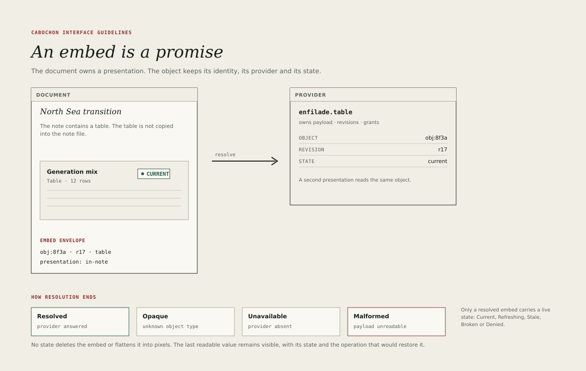

# Embeds

An embed is a promise. The document owns a presentation; the object keeps its
identity, its provider and its state. The promise holds when the provider is
present, and it must remain intelligible when the provider is not.

## The envelope

An embed records four things.

- The object's identity.
- The presentation chosen for this document.
- The provider that can resolve the object.
- The last known state and revision.

The document does not store a rendered copy as its primary content. A cached
rendering may exist for speed, but it is a cache, clearly replaceable from the
object.

## The provider

The provider owns the payload, the revisions and the grants. It resolves an
identity to the data the presentation needs. The document asks the runtime to
resolve the embed; it does not reach the provider directly.

The interface consequence is that an embed can fail independently of the
document. The document remains open, printable and exportable while one embed
is unavailable.

## Resolution states

Resolution asks whether this machine can turn the envelope into a presentation.
It is separate from the live relationship state.

| Resolution  | Meaning                                        | What remains                        |
| ----------- | ---------------------------------------------- | ----------------------------------- |
| Resolved    | A provider loaded the object                   | The presentation and its live state |
| Opaque      | The bytes are intact; no provider is installed | Export original                     |
| Unavailable | The provider exists but cannot load the object | Name, identity, retry               |
| Malformed   | The provider rejected the payload              | Name, identity, diagnosis           |

Only a **Resolved** embed carries one of the five live states from
[Live relationships](08-live-relationships.md). An Opaque, Unavailable or
Malformed embed has no live state and shows its resolution state instead. Stale
and Denied are properties of a resolved relationship, not alternative
resolution states.

Opaque is not a failure of the document. It is a promise kept: the content is
preserved even though this machine cannot render it. The placeholder must say
so and offer **Export original**.

## Inserting an embed

Insertion is one action with one undo step. The user chooses an object from the
project, the clipboard or a provider's picker, chooses one of the available
presentations in the same surface, and confirms once. The embed appears with
its resolution state and, once resolved, its live state; the document is marked
modified.

If the provider cannot resolve the object, the embed is still inserted in its
resolution state. The reference is never silently discarded because a provider
is missing.

The flow must not insert a rendered image by default. If the user wants an
image, **Export** and **Insert image** are separate commands.

## Presentations

A presentation is chosen per embed. Changing it changes the document, not the
object, and is undoable.

- A presentation that is unavailable is greyed with a reason.
- A presentation that would exceed the document's width offers a compact
  variant rather than clipping.
- A presentation may be changed from the embed's action bar or the
  inspector.
- The document remembers the presentation across reopen and export.

## Printing and export

An embed prints through its chosen presentation, using the shared Burin target.
If the provider is unavailable at print time, the last cached presentation
prints with a visible state mark, and the preflight report names the unresolved
embeds.

The export manifest records each embed's identity, provider, presentation and
state. It must not claim that an unresolved embed was rendered from live data.

## Removing an embed

Removing an embed removes the reference from the document. It does not delete
the object. The confirmation, if any, says exactly that.

Deleting the object is a separate action. If the object is referenced
elsewhere, the deletion dialog lists the references and requires an explicit
choice.

## Embedding across applications

A note may embed a dataframe, a diagram, a bitmap, a currency value or a live
formula result. The embed's furniture is the same in every host: a state edge,
a name, a metadata line, a state chip and an action bar.

The host application must not add its own private chrome around the embed. A
dataframe embedded in a note and a dataframe embedded in a report should be
recognisably the same object in the same envelope.

## Accessibility

An embed exposes:

- its accessible name, from the object's name;
- its role, from the object's type;
- its state, as a described status;
- its content, through the presentation's accessibility tree where the
  provider supports it;
- an action to open the object and an action to inspect it.

A denied embed must not expose the protected value through an accessible name
or description.

## What an embed is not

- A screenshot.
- A copy of the object's data.
- A link that breaks when a file moves.
- A reason to close the document when a provider fails.
- A promise that can be silently converted into a picture.
