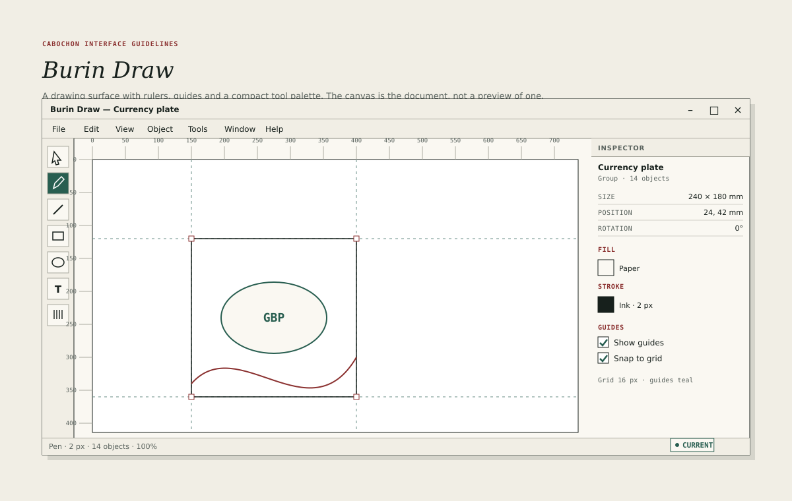

# Burin Draw

Burin Draw is the studio's vector and composition instrument. Its canvas is the
document, not a preview of one. Rulers, guides and the inspector all speak in
the document's physical units, so that what is drawn is what will print.

## Layout

- Tool palette: 48 units wide, one column of the **studio tool button** role
  from [Spacing and metrics](14-spacing-metrics.md): 32 units high, 28 units
  minimum, with a 16-unit glyph and a 28-unit effective target.
- Rulers: 20 units along the top and left, in the document's unit.
- Canvas: the flexible remainder, on a white page with a one-unit keyline in
  the decorative line role.
- Inspector: 240 units, showing geometry, fill, stroke and guides.
- Status line: active tool, stroke width, object count and zoom.

The studio tool button is a declared variant of the tool button, not a separate
control. It is 32 units high because the studio instruments run at a larger
default interface scale; it never drops below the 28-unit minimum, and its
glyph and target do not grow with the band. A studio instrument that uses the
document profile uses the ordinary 30-unit tool button instead.

The tool palette contains select, pen, line, rectangle, ellipse, text and hand.
The active tool uses the selected-fill and selected-text roles from
[Palette](12-palette.md). A tool's options appear in the tool strip or the
inspector, never in a floating palette that covers the canvas.

Each of these is a **canvas tool** in the sense of
[Selection and tools](24-selection-tools.md). The tool palette shows which tool
is active, the status line names it, and Escape returns to select. A tool has
no **Insert** button; its effect is the gesture it completes.

## Units and rulers

A drawing declares its unit: millimetres, points or pica pixels. That unit is a
document unit, and it is not the logical unit that measures the interface. The
three spaces are distinct and never silently converted.

| Space     | Measured in       | Example               |
| --------- | ----------------- | --------------------- |
| Interface | logical units     | A 32-unit tool button |
| Document  | the declared unit | A 120 mm page         |
| Sample    | stored pixels     | A 300 ppi bitmap      |

- Rulers show the declared unit and tick at a spacing suited to the zoom.
- The inspector shows position and size in the declared unit.
- The status line shows the pointer position in the same unit.
- Changing the unit changes the display, not the geometry.
- A document without a declared physical size uses document pixels and reports
  that it has no print intent.

The unit is part of the document. An export must record it in the manifest. A
figure caption or a legacy note that says "pixel" for an interface measurement
means the baseline logical unit; normative prose uses the logical unit.

## Guides and grid

- Guides are dragged from the rulers and drawn as one-unit dashed lines in the
  decorative teal role.
- The grid is 16 document units by default and may be changed in the inspector.
- **Show guides** and **Show grid** are view settings; neither prints.
- Snapping is 8 document units to the grid and 4 document units to a guide, and
  may be disabled with a modifier. Snapping is computed in document space, so
  it is unaffected by the interface scale and by the canvas zoom.
- A guide may be locked, named and deleted from the inspector.

Teal is used here as decoration and as a non-printing aid. It never carries
text, and it must never be the only way to distinguish a guide from a drawn
line: the guide is dashed and the drawn line is solid.

## Selection and geometry

- A selected object carries a 2-unit oxide outline with 8-unit square handles
  at its corners, drawn in interface space and never in document space. The
  handles keep their size as the canvas zooms.
- A multi-selection shows one outline around the group and a thin outline
  around each member.
- Dragging a handle resizes; dragging an edge moves one side; dragging inside
  moves the object.
- The inspector shows position, size and rotation, and accepts typed values.
- A transform is one undoable transaction, even when it is performed with
  several pointer movements.

## Drawing

- The pen tool creates paths with nodes and 2-unit node handles.
- Shapes are drawn with the current fill and stroke; the inspector shows both
  as 24-unit swatches, whose effective hit regions are expanded to 28 units.
- Text is created with the text tool and uses the document's type settings.
  Text remains text in every output that supports it.
- An object's stroke may be 0, 1, 2, 4 or 8 document units, or a value typed in
  the inspector. It is not an interface measurement.
- The canvas does not anti-alias a hairline stroke at 100 per cent zoom, so
  that hairlines remain hairlines.

## Layers and grouping

The first batch provides grouping and a flat object list, not a full layer
stack.

- Grouping preserves each object's identity and its relative geometry.
- Ungrouping restores the members.
- The object list is ordered front to back and supports renaming.
- Hiding an object in the list removes it from display and from export without
  deleting it.

## Print and export

Burin Draw submits its scene to the shared Burin output contract. Display, PDF,
print, raster and clipboard targets read the same resolved scene for their
declared intent.

- The display intent resolves the editing view; the print intent resolves the
  print presentation at the declared output intent. Geometry is compared only
  where the participation policy includes the same nodes.
- A document with a declared physical size prints at that size, with crop
  marks only when the user asks for them.
- A document without a physical size prints at a declared scale, shown in the
  print surface.
- Guides, grid and selection handles never print.
- Text remains selectable in PDF and readable in the accessibility tree.
- The export reads one accepted snapshot and stages its output before
  publication, so an interruption never pairs new pages with an old manifest.

## What Burin Draw is not

- A bitmap editor. Pixels belong to the bitmap instrument.
- A page-layout tool. Multi-page imposition belongs to Cabochon Press.
- A format converter. Export uses the shared output contract.
- A canvas that owns objects privately. Every drawn object has an identity and
  can be inspected.

## Testing

A reviewer should draw a shape, set a physical size, export to PDF and print,
and confirm that the geometry, the text and the hairline weight agree with the
canvas within the tolerances in [Output parity](37-output-parity.md).
