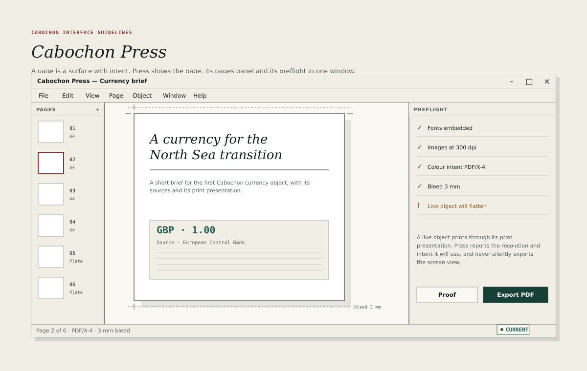

# Cabochon Press

Cabochon Press is the studio's page-layout instrument. It arranges pages,
places live objects and prepares print-bound output. Its defining promise is
that it reports what it will do before it does it.

## Layout

- Pages panel: 150 pixels, listing every page with a thumbnail, a number and
  its size or kind.
- Page plane: the flexible remainder, showing the current page with its bleed
  and crop marks.
- Preflight panel: 300 pixels, listing checks and their outcomes.
- Status line: page number, output intent and bleed.

The page plane is the document. The pages panel and preflight are panes; they
may be collapsed but not hidden entirely while a print operation runs.

## Pages

A page declares a size, an orientation and a bleed.

- The default page is A4 portrait with a 3-millimetre bleed.
- The pages panel shows the current page with a 2-pixel oxide keyline and the
  others with a 1-pixel line.
- A page's number is metadata; its name is optional.
- Reordering pages is a drag in the panel and one undoable transaction.
- A page may be a plate, a spread or a cover, and the panel says which.

The page plane draws the bleed as a teal dashed rule outside the trim and the
crop marks as ink hairlines. Neither bleed nor crop marks are part of the
document's visible design; they are production marks.

## Placing objects

A page may contain:

- drawn objects from Burin Draw;
- embedded objects, such as a dataframe or a currency value;
- text frames;
- images with a declared resolution and intent.

A placed object keeps its identity. The page stores its placement and its
presentation, not a flattened copy. A live object prints through its print
presentation, and the preflight reports which presentation will be used.

## Preflight

Preflight runs on demand and before every export. It checks:

- fonts embedded, or a substitution declared in advance;
- images at the required resolution;
- colour intent supported by the output;
- bleed sufficient for the trim;
- live objects that will use a print presentation;
- live objects whose provider is unavailable;
- objects outside the trim area that may be clipped.

Each check has three outcomes: pass, warning and failure.

- Pass uses a pine check mark.
- Warning uses amber ink and a short explanation.
- Failure uses oxide and blocks the export until it is resolved or explicitly
  overridden.

A warning must not be phrased as a failure, and a failure must not be
dismissible without a record in the export manifest.

## Export

The primary action is **Export PDF**, with **Proof** beside it.

- **Proof** renders the current page at screen resolution with marks and a
  preflight summary, for review only.
- **Export PDF** writes the full document at the declared intent, with an
  accompanying manifest.
- The export surface names the intent, the resolution, the bleed and the
  colour conversion it will apply.
- The manifest records each page, each placed object, its identity and the
  presentation used.

The export must not silently flatten a live object that could have been
rendered from its provider. If flattening is necessary, the preflight says so
and the manifest records it.

## Print

Printing uses the host's print portal. Cabochon Press prepares the scene and
the manifest; the host owns the printer dialog.

Press must not imitate a printer driver. It may show a preview and a summary,
but the choice of printer, paper source and host-specific options belongs to
the portal.

## Failure

- A missing font blocks export unless the user chooses a recorded substitution;
  either way, the message names the missing font and, where one was chosen, the
  substitute.
- An image below the required resolution warns and reports its effective
  resolution.
- An unavailable provider warns, prints the last cached presentation with a
  state mark and records the substitution.
- A failed write leaves the previous export intact and reports the path and
  the reason.

## What Cabochon Press is not

- A word processor. Long-form writing belongs to Facet Notes.
- A bitmap editor.
- A printer driver.
- A way to export a screenshot of the screen. Every page is rendered from its
  scene.

## Testing

A reviewer should place a live object, run preflight with the provider present
and absent, export both times, and confirm that the manifest tells the truth in
each case.
