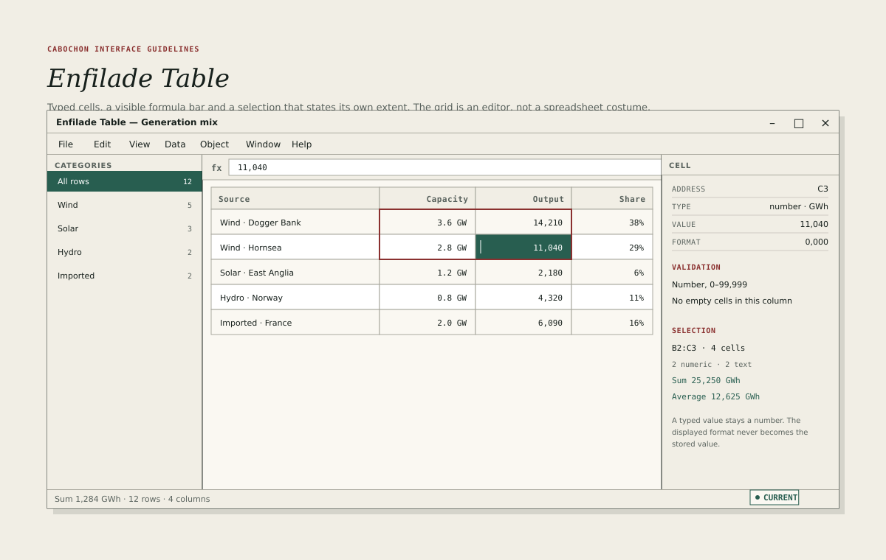

# Enfilade Table

Enfilade Table is the studio's dense data instrument. It edits large typed
tables, their validation rules and their references to other objects. The
workspace dataframe editor edits a single embedded dataframe; Enfilade Table is
where a dataset with many rows, several categories and cross-table references
is examined and maintained.

## Layout

- Categories panel: 210 logical units, listing saved filters with row counts.
- Formula bar: 34 logical units, showing the selected cell's expression.
- Grid: the flexible remainder.
- Cell inspector: 240 logical units, showing address, type, value, format,
  validation and selection aggregates.
- Status line: aggregate, row count and column count.

The categories panel is the instrument's navigator. It lists **All rows** and
each saved category, with the selected category drawn in the selected-fill role.

## The grid at scale

- Header row: 30 logical units, with column names in the 12-unit operational
  role, bold and letter-spaced.
- Body rows: 28 logical units minimum, 34 preferred.
- Column widths are draggable and remembered per view.
- The grid virtualizes rows and columns; a 100,000-row table remains
  scrollable at interactive speed.
- Frozen columns keep the key column visible while scrolling horizontally.
- Numbers align to the trailing edge with tabular figures; text aligns to the
  leading edge.
- The selected cell uses the selected-fill and selected-text roles; the selected
  range uses a 2-unit oxide outline; the active cell keeps a contrasting caret.

## Types and value production

A column declares four independent things: its scalar type, its nullability,
its validation rules and its value-production mode.

The studio table supports the workspace scalar types, including **reference**
and **text**, and adds these capabilities:

- **enum**, constraining a column to a declared set of values;
- **blob**, holding opaque bytes with a declared media type;
- **computed column**, producing each cell's value from an expression.

Reference is not an additional studio type; it is the same reference type the
workspace dataframe editor already offers.

A computed column is a provider-owned object with its own identity. Editing its
expression edits the column definition and commits a new revision of that
object; it does not allocate a fresh identity and does not edit each cell. Each
cell result has an address in the column's result space, and that address is
stable for the entity the cell represents, not for the row's current display
position.

A reference column resolves names through the provider and shows **Denied** or
**Unavailable** without revealing the referenced value or protected metadata.

## Validation at scale

Structural type validity and semantic validation are different.

- A value that does not match its column's scalar type is rejected at entry and
  leaves the previous typed value intact. This is a structural error.
- A value that matches its type but violates a business rule is accepted, marked
  and reported. This is a validation violation.

Validation rules are declared per column and may depend on other columns.

- The inspector lists every rule that applies to the selected cell, with its
  scope and message.
- A violated cell carries a 2-unit oxide corner mark and a message on focus.
- The status line reports the number of violating rows in the current category,
  subject to the disclosure policy.
- The categories panel can create a **Violations** category, which is a view,
  not a stored filter on the object.
- Validation never blocks reading, sorting, filtering or exporting. It marks
  the data and reports it.

## References and joins

A reference cell shows the referenced object's name and its state. A join
between two tables is a computed view, not a mutation of either table.

- Creating a join declares its key columns and its output columns.
- The join is previewed before it is saved.
- A broken reference appears in the **Broken references** category and offers
  **Restore**, **Rebind** or **Remove reference**, named by their identity
  effect. A general **Create** does not silently replace the missing identity.
- Deleting a referenced object warns and lists the tables the runtime knows and
  the user may inspect. It says when the assessment may be incomplete and does
  not enumerate protected references.

## Categories

A category is a saved filter with a name and a count. It is stored in the view,
not in the table object.

- Creating a category from the current filter is one command.
- A category may be pinned to the top of the panel.
- A category that matches no rows says so and offers to edit its filter.
- The **All rows** category is always present and cannot be deleted.

## Formula bar and computed columns

The formula bar edits the selected cell or the selected computed column's
definition, depending on the selection.

- The bar shows the expression, not the formatted result.
- A computed column's expression names its sources in the inspector.
- A malformed expression is reported at its location and does not change the
  committed column definition. The last committed result remains intact and is
  not presented as a fresh computation.
- A computed column that becomes stale keeps its last value and reports its
  state.
- Editing an existing expression updates the same computed-column object and
  commits a new revision. Cancelling the edit preserves the committed
  expression, result and identity.

## Import and export

- Import accepts CSV, TSV, Parquet and a Cabochon table bundle.
- Import previews the inferred types, the delimiter and the encoding before
  committing.
- A failed record is reported with a structured location: record and field plus
  the physical line span for delimited text, row group, row and column for
  Parquet, or a file-level failure when the format cannot localise it.
- A failed record does not abort the imported rows in an explicit partial-import
  mode. That mode states its commit units, its undo grouping and its recovery
  behaviour. An all-or-nothing import commits nothing on failure.
- Export writes the table's values and its declared types, not its formatted
  display.
- A plain delimited export cannot carry types, references or formulas. It
  declares those losses and may write a sidecar schema or a Cabochon table
  bundle when the user asks for a type-preserving export.
- The export manifest records the table's identity, revision, encoding, declared
  losses and any computed columns that were evaluated.
- The export is a user export, not a conformance bundle: it writes the requested
  table file and its manifest, not unrelated renderings. A conformance bundle
  is a separate review command.

## What Enfilade Table is not

- A spreadsheet with free-form cells and implicit types.
- A database administration console.
- A charting tool. Charts read the table and present it elsewhere.
- A place where a reference is copied as a string. References keep identity.

## Testing

A reviewer should build a table with a reference column, break the reference,
create a violations category, restore the reference and confirm that the
table's identity, committed content and exported types are unchanged by the
view operations. Sorting, filtering and category changes alter view state only.
Reference repair is a content operation and is tested separately. A stale
writer remains detectably stale after an intervening edit and undo.
