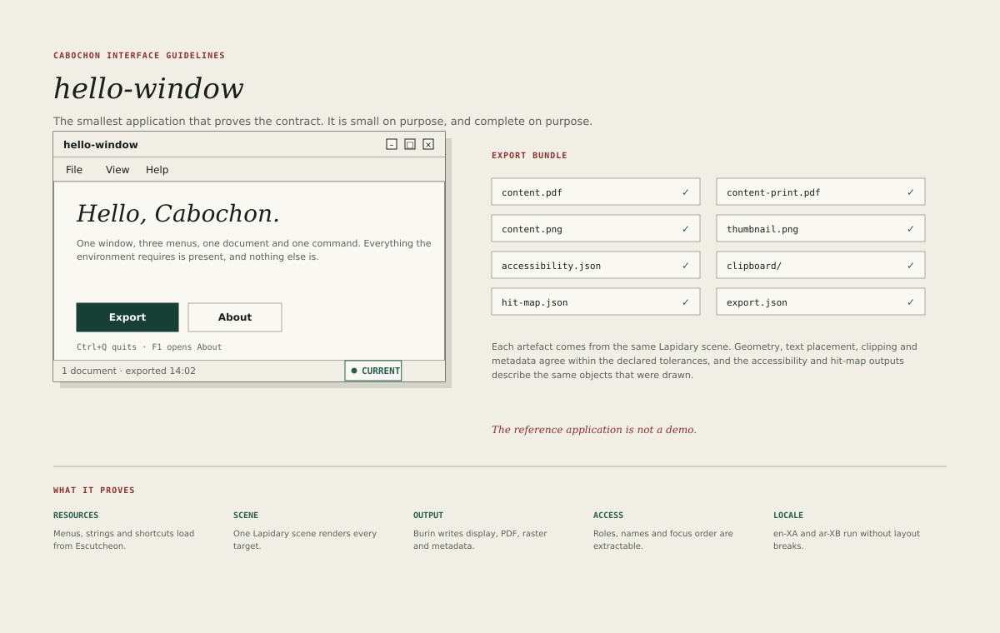

# hello-window

`hello-window` is the smallest application that proves the Cabochon application
contract. It is small on purpose and complete on purpose: every requirement the
environment makes of an application is present, and nothing else is.

It is not a demo. It is the program that fails loudly when a contract regresses.

## The window

`hello-window` has one window, three menus and one document.

- **File** contains **New**, **Open**, **Export** and **Quit**.
- **View** contains **Zoom** and **Appearance**.
- **Help** contains **About** and **Diagnostics**.
- The document plane holds a greeting, a short explanation and two buttons:
  **Export** as the primary action and **About** as the secondary.
- The status line reports the document and the last export time.

Every menu, string, icon and shortcut is loaded from Escutcheon resources. The
application must not hard-code a menu or a label. Changing the resource bundle
must change the interface without recompiling the application.

## What it proves

The reference application exercises five contracts.

1. **Resources.** Menus, strings, icons and shortcuts load from Escutcheon,
   including a pseudo-localized bundle.
2. **Scene.** One Lapidary scene describes the document, its text, its
   controls and its hit regions.
3. **Output.** Burin renders that scene to display, PDF, print, raster,
   thumbnail, clipboard, accessibility and hit-testing targets.
4. **Access.** Every control has a role, a name, a state and a position in the
   focus order.
5. **Locale.** The application runs under `en-XA` and `ar-XB` without layout
   breaks, clipped labels or reversed reading order.

A contract test that omits any of these is incomplete, because each one is a
promise the rest of the environment depends on.

## The export bundle

**Export** writes a bundle with eight artefacts:

| Artefact             | Content                                      |
| -------------------- | -------------------------------------------- |
| `content.pdf`        | Screen-oriented vector output                |
| `content-print.pdf`  | Print-oriented output with intent and bleed  |
| `content.png`        | Raster at the declared scale                 |
| `thumbnail.png`      | Small raster for lists and previews          |
| `accessibility.json` | Roles, names, states and bounds              |
| `clipboard/`         | Text and geometry for the clipboard          |
| `hit-map.json`       | Hit regions keyed by object identity         |
| `export.json`        | Manifest of intents, tolerances and versions |

All eight come from the same scene. Geometry, text placement, clipping and
metadata must agree within the tolerances in
[Output parity](37-output-parity.md). The accessibility and hit-map outputs
must describe the same objects that were drawn.

## What it must not do

- Draw directly to the screen outside Lapidary.
- Build a PDF through a second layout path.
- Hard-code a string that belongs in a resource.
- Omit the status line, the menu bar or the accessibility tree because the
  application is small.
- Add features that the contract does not require. The point of the
  application is that its surface is entirely explained by the contract.

## Using it as a review instrument

A reviewer can compare a new application with `hello-window` and ask:

- Does the new application load its menus from resources?
- Does it render through a Lapidary scene, and can that scene be extracted?
- Does its export bundle contain the same eight artefacts?
- Does its accessibility tree describe every control?
- Does it survive `en-XA` and `ar-XB`?

A negative answer is a contract defect, not a stylistic preference.

## Relationship to the guidelines

`hello-window` follows every rule in this book that applies to it: the window
bands, the menu order, the control sizes, the focus ring, the state chip and
the status line. It is the reference for the smallest complete surface, and
therefore the first place a new developer should look.
