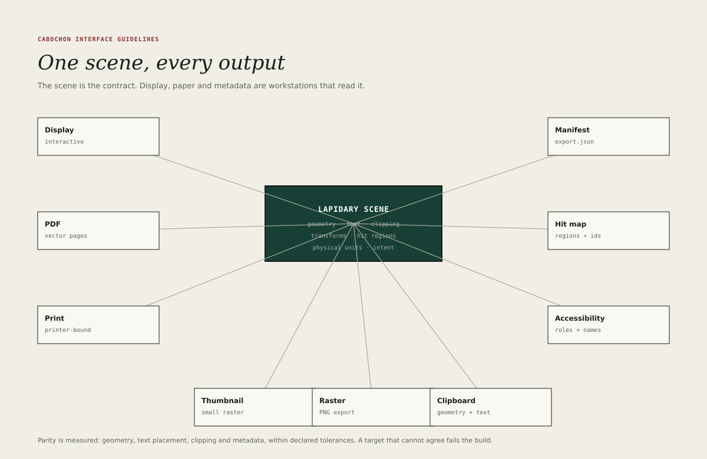

# Output parity

Cabochon renders every surface from a Lapidary scene through a Burin target.
Display, PDF, print, thumbnail, raster, clipboard, accessibility, hit-testing
and manifest output are workstations that read the same scene. Parity is the
claim that the outputs of one declared intent describe the same resolved
drawing.

## Targets, artefacts and encodings

A **target** is a renderer's purpose. An **artefact** is a file that is
published. An **encoding** is the format of that file. The three are not
interchangeable.

| Target        | Purpose                                          | Artefact                                  |
| ------------- | ------------------------------------------------ | ----------------------------------------- |
| Display       | Interactive pixels at the current zoom and scale | None; the display is not an exported file |
| PDF           | Vector pages with selectable text                | Yes                                       |
| Print         | Printer-bound output at a declared intent        | Yes                                       |
| Thumbnail     | Small raster for lists and previews              | Yes                                       |
| Raster        | PNG or equivalent at a declared scale            | Yes                                       |
| Clipboard     | Text plus geometry for other applications        | No; a transfer                            |
| Accessibility | Roles, names, states and bounds                  | Yes, as a diagnostic projection           |
| Hit map       | Regions keyed by presentation instance           | Yes                                       |
| Manifest      | Intents, snapshots, tolerances and substitutions | Yes                                       |

Nine logical targets therefore produce eight persisted artefacts. A target may
omit a feature that it cannot represent. It may not invent geometry, text or
state that the resolved scene does not contain.

The encodings available for an artefact depend on the export profile. A user
export, a native project bundle and a conformance bundle are different
operations with different obligations; they are described under
[Export profiles](#export-profiles).

## Resolved scenes and intents

A canonical document model describes the document's objects, relationships and
placements. It is not itself drawable. Rendering resolves it into a **resolved
scene** for a declared **presentation intent**:

- **Display** resolves interactive presentation at the current zoom and scale.
- **Print** resolves the print presentation of each object at the declared
  output intent.
- **Thumbnail** resolves an identity-bearing reduction.
- **Raster** resolves a declared scale and sample space.
- **PDF** resolves paginated vector pages.
- **Clipboard**, **accessibility** and **hit map** resolve semantics and bounds
  without pixels.

A resolved scene names its snapshot, its participating nodes, its coordinate
transforms and its applicable tolerances. Parity compares the outputs of the
same resolved intent. It does not compare the display of an editing document
with a paginated print layout, and it does not treat a declared print
presentation as an unreported substitution.

## The snapshot

Every output of one bundle reads one **accepted snapshot**:

- the document revision and the accepted source-revision vector;
- the authority decision that permitted each participating object;
- the presentation definition and intent chosen for each placement;
- the rendering and schema versions.

The snapshot is captured before rendering begins. A live source that changes
while the bundle is rendering does not enter half the artefacts. Every artefact
and the manifest identify the same snapshot.

## Participation policy

Not everything drawn on screen belongs in every output.

- Application chrome, menus, panels, focus rings and tool palettes do not enter
  document output.
- Guides, grids, selection handles, crop marks and editing aids do not enter
  print or PDF output.
- State marks do enter every target that renders the object at interface scale,
  including print. A thumbnail at least 48 pixels on its shorter side carries a
  shape mark; a smaller thumbnail carries the state in its list row and in the
  manifest.
- A declared print presentation participates with its own geometry and is
  recorded in the manifest. A different print presentation is an intent choice,
  not a parity defect.
- A diagnostic whole-interface export is a separate operation from a user's
  document export and declares that it includes chrome.

## The reference scale

Parity is measured at a reference density of 96 pixels per inch at 100 per cent
zoom. PDF and raster targets are converted to the reference density before
comparison, and print output is measured in millimetres at the declared output
intent. A thumbnail is compared for identity, text and state rather than for
sub-pixel geometry. Accessibility and clipboard targets carry no pixels; they
are compared by instance identity, text content and bounds in scene units.

The logical unit, interface scale and document zoom are defined in
[Spacing and metrics](14-spacing-metrics.md). Parity tolerances are expressed
in the logical unit and converted through the declared transforms; they are not
hard-coded device pixels.

## What must agree

- **Geometry.** Object bounds, clipping and transforms agree within 0.5 logical
  units at the reference density, and within 0.25 millimetres at print size.
- **Text.** Text placement agrees within 1 logical unit at the reference density
  and within 0.25 millimetres at print size, and text remains text in PDF and
  in the accessibility projection wherever the format supports it.
- **Clipping.** A clipped object is clipped identically in every raster and
  vector target, and its hit region is clipped to match.
- **State.** A state mark appears in every target that renders the object at
  interface scale, including print. A downscale must never leave colour as the
  only carrier of state.
- **Metadata.** Object identity, revision, presentation instance and snapshot
  appear in the manifest for every target that can carry metadata, subject to
  the disclosure policy in [Live relationships](08-live-relationships.md).

## Text

Text is never converted to outlines to make parity easier.

- PDF keeps text as text, with embedded fonts.
- Print output embeds fonts or applies a substitution declared in advance and
  recorded in the manifest. A substituted font is still embedded when the
  chosen profile requires it.
- Raster output may anti-alias, but its placement must match the vector output.
- Accessibility extraction reads the same text runs that were drawn, through
  the scene's semantic projection.
- Clipboard output carries text and its geometry separately.

A font substitution is a documented event, not a silent change. The manifest
records the original font, the substitute, the reason and the effective font
set.

## Colour

- Display targets honour the interface palette.
- Print targets declare a colour intent and convert explicitly.
- A colour outside the target's gamut is reported in preflight and recorded in
  the manifest.
- The output must not apply a display-only tint to a print target.
- A content colour authored by the user is preserved within the target's gamut;
  it is not coerced into an interface role.

## Hit regions

The hit map describes the same objects that were drawn. A hit result identifies
a presentation instance or scene node, and optionally maps to a semantic object
through the integration boundary. Two instances of one semantic object have
distinct hit regions and distinct scene identifiers.

A control drawn at a 28-unit target has a hit region of at least 28 units,
extended by any declared hit slop. The hit region is clipped by its parent and
transformed with the object. The effective target is the region that remains
after clipping, not the unclipped rectangle or the glyph.

A hit map that disagrees with the drawing is a contract failure, because it
makes the visible interface dishonest.

## Failure behaviour

A target may fail on one object, and the renderer may fail as a whole. They are
different failures with different obligations.

**Target failure.** If a target cannot render an object, it reports the
object's instance identity and the reason, and renders the rest of the scene. A
partial artefact is marked as partial in the manifest.

**Presentation-path failure.** If the display renderer fails entirely, the
application enters a bounded fallback surface rather than pretending the last
frame is current. The fallback may be an independent surviving chrome path that
still draws the status line and diagnostics, or a plain error surface. It must:

- keep the last committed document model intact;
- disable mutations whose visible target cannot be validated, so that no click
  operates on a new invisible object under old pixels;
- tie any retained pixels and hit regions to the same snapshot;
- redact before it preserves. A retained pixel that now contains denied
  information is discarded even if that leaves an empty region.

**Bundle failure.** A failed write leaves the previous published bundle intact.
A bundle is staged and published as a unit, so interruption never pairs a new
artefact with an old manifest.

Silence is never an acceptable failure mode. A target that cannot render must
say so, and a renderer that cannot draw must offer a reachable diagnostic path.

## The manifest

Every export writes `export.json`, which records:

- the snapshot identifier, the scene's version and the renderer's version;
- the profile, target, intent and encoding of each artefact;
- the declared tolerances, which are the values in this chapter and may not be
  looser;
- each participating instance's identity, semantic mapping, revision and
  presentation;
- font substitutions and colour conversions;
- objects that could not be rendered and why;
- losses declared by a lossy encoding;
- whether the output is complete, partial or staged.

The manifest is the evidence that the other artefacts are trustworthy. It is
also the record a support conversation needs. It is itself subject to the
metadata disclosure policy: it does not list a protected identity or revision
that the current grant withholds.

## Export profiles

The environment distinguishes three export operations.

| Profile            | Purpose                                                       | Obligations                                                                               |
| ------------------ | ------------------------------------------------------------- | ----------------------------------------------------------------------------------------- |
| User export        | The file the user asked for, such as a PDF, CSV, SVG or image | The requested artefact, its encoding, its declared losses and a manifest entry            |
| Native bundle      | Move a project or object between Cabochon installations       | Reconstructable payload, schema, relationships and declared closure; no grants or secrets |
| Conformance bundle | Prove every required target class for a release               | The full artefact set, the shared snapshot, the tolerances and the profile checks         |

A conformance bundle is a review and test command. It is not an unexplained
side effect of every CSV export. An ordinary user export creates the file the
user asked for and the metadata that file needs.

The supported encodings are declared per profile. SVG is a supported vector
encoding for Burin Draw documents and diagram export in the studio profile; it
is not a Burin target, and a profile that does not require it does not
advertise it. PDF/X conformance is claimed only by a profile that validates the
chosen PDF/X level; otherwise the output is described as PDF with a declared
colour intent, not as PDF/X.

## Testing parity

A parity test renders one resolved scene under a declared intent that varies
clipping, text, transforms, hit regions and presentation choice, then compares
the targets.

- Geometry and text are compared numerically, not by eye.
- Clipping is compared at the edges, where rounding differs.
- Hit regions are compared with the instance regions the scene declares.
- Accessibility output is compared with the scene's semantic annotations.
- A failure names the target, the instance and the tolerance that was exceeded.
- A deliberately different print presentation passes its declared
  correspondence contract instead of failing a screenshot equality test.
- A negative fixture renders one artefact from a newer snapshot and must fail.

A visual check is still required. It catches the defects that a numeric
comparison cannot: a missing glyph, a wrong state colour, a shadow that
printed. The SVG proof sheet in this repository is an example of that check for
figures, and the same discipline applies to application output.
