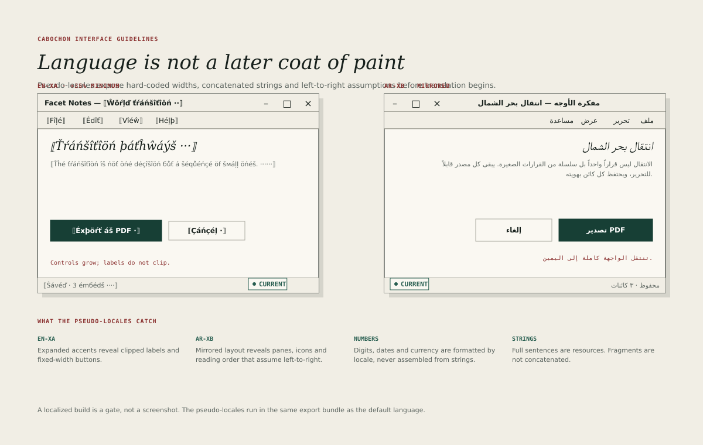

# Localization

Localization is not a coat applied after the interface is finished. An
interface that only works in English is an interface with untested layout,
untranslated resources and unexamined assumptions about direction.

Cabochon treats localization as a gate, run with the same rigour as contrast
and output parity.

## The two pseudo-locales

Every application ships with two pseudo-locale builds.

- **`en-XA`** expands every string with accented characters and pads it by at
  least 35 per cent. It reveals clipped labels, fixed-width buttons and
  single-line fields that cannot grow.
- **`ar-XB`** mirrors the layout right-to-left and substitutes right-to-left
  text. It reveals panes, icons, reading order and hit regions that assume
  left-to-right.

Both builds run the full export bundle. A screenshot of the main window is not
a localization test.

## Resources

Resources cover application-authored interface text. They do not cover
user-authored content, and they do not silently own provider-supplied text.

- Every user-visible string the application itself authors is a resource keyed
  by meaning, not by its English text.
- A resource is a complete sentence or a complete label, never a fragment that
  is concatenated at run time.
- Placeholders are named and typed, and a translation may reorder them. An
  inserted object name, identity or path keeps its own direction through bidi
  isolation; the surrounding sentence does not reverse it.
- Plural forms use the locale's plural rules, not an `if` on the count.
- Accelerator keys are declared separately from the label, so that a
  translation can choose a different letter.
- A missing resource is a build failure, not a fallback to English.

A diagnostic supplied by a provider is a different class. It is displayed as
the provider's text with the provider named, it is not rewritten into an
application resource, and it is not required to exist in every locale. If no
translation is available, the interface says that the message is in the
provider's language rather than pretending it is localized.
Application-authored labels around it remain resources.

The last rule matters. A silent fallback hides untranslated surfaces until a
user finds them. A missing key must fail the pseudo-locale gate.

## Expansion and layout

Text grows when it is translated. The layout must absorb the growth. Shared
bands are **baseline heights**, not immutable boxes: a band grows when its
content's line boxes and padding require it, while its component minima still
hold.

- Menu items and button labels do not truncate; the control grows or the label
  wraps. Table cells and metadata truncate at the end with an ellipsis and a
  tooltip. No label may overlap its neighbour.
- Buttons and fields have a minimum size, not a fixed size derived from
  English text.
- A menu bar that cannot fit its menus moves whole menus into **More**. A tool
  strip that cannot fit its commands moves a whole group into its overflow
  menu. Neither shrinks a target below 28 units.
- A dialog that grows beyond the window reflows or scrolls; it does not clip.
  Its title and its action row stay fixed, and its body scrolls. A button row
  that no longer fits wraps onto a second row rather than shrinking its
  buttons. A dialog never grows wider than the window's feasible width, and it
  never hides its primary action below the fold.
- A status line may shorten its message but must keep its state. It keeps its
  object count only when the disclosure policy permits that class; otherwise it
  uses the non-count alternative that the state carrier defines.

The 35 per cent expansion is a floor, not a target. German and Finnish often
exceed it; the pseudo-locale is designed to fail early.

## Direction

Direction is a property of the interface, not of each widget.

- Pane roles do not reverse. The navigator is the logical leading pane and the
  inspector the logical trailing pane in both directions. Their physical
  positions mirror: in a right-to-left interface the navigator appears on the
  right and the inspector on the left.
- Menu bars mirror, and menu items align to the reading edge.
- Icons that depict direction, such as arrows and playback controls, mirror.
  Icons that depict objects, such as a document or a pen, do not. Mirroring is
  declared per icon in its metadata; the interface does not apply a global flip
  to an icon set, because that also reverses non-directional glyphs.
- Text alignment follows the direction of the text, which may differ from the
  direction of the interface.
- Hit regions and focus order mirror with the layout.
- Scrollbars move to the reading edge's far side.
- Position is described with leading and trailing edges, not left and right,
  except where a rule is deliberately absolute.

Component definitions mark which placements are logical and which are
deliberately physical. A physical placement is a stated exception, such as a
canvas ruler whose origin is fixed by the document, and it keeps its meaning in
every direction. The navigator's "left" pane and the inspector's "right" pane
are logical leading and trailing positions and mirror. A ruler's zero mark, a
page's binding edge and a document's own coordinate origin are physical and do
not mirror.

A document's content keeps its own direction. An Arabic note inside an English
interface is right-to-left; an English quotation inside an Arabic interface is
left-to-right. The interface direction is the frame, not a claim about every
string.

## Numbers, dates and units

Values are formatted by locale, never assembled from pieces.

- Numbers use the locale's grouping and decimal separators.
- Dates use a named format such as a short date, not a hand-built pattern.
- Currency uses the currency's own minor units and the locale's placement.
- Units are converted only when the user asks; the stored value keeps its
  unit.
- Sorting uses the locale's collation for text and numeric order for numbers.
- A right-to-left locale may still use Western digits where that is the
  locale's convention. The locale decides.

## Fonts

- The interface font stack includes a humanist sans with broad coverage and a
  fallback chain.
- A missing glyph is reported in the pseudo-locale gate rather than displayed
  as a blank box in production.
- Metadata and interface text may use different fonts, but both must cover the
  shipped locales.
- A translated string must not change the type scale or the line height.

## Testing

A localization gate passes when:

- every resource key exists in every shipped locale;
- both pseudo-locales build and export without clipping or overlap;
- the focus order and hit regions match the mirrored layout;
- dates, numbers and currency render in the locale's format;
- the accessibility tree exposes translated names, not resource keys;
- no string is concatenated from fragments.

The gate runs in continuous integration and produces a report naming the
window, the widget and the overflowing string. A screenshot is evidence, not
the gate.

The two pseudo-locales are stress fixtures. Passing them shows that the layout
absorbs expansion and mirrors; it does not prove that a script renders, that a
font covers the language, or that a translation is correct. Those are tested
separately for each shipped locale, with real text in the real font.

## What localization is not

- Translating the menus and leaving the dialogs in English.
- Reversing the layout without reversing the reading order.
- Assuming that a longer string can be truncated silently.
- Treating a locale as a language. A locale includes direction, collation,
  formats and conventions.
