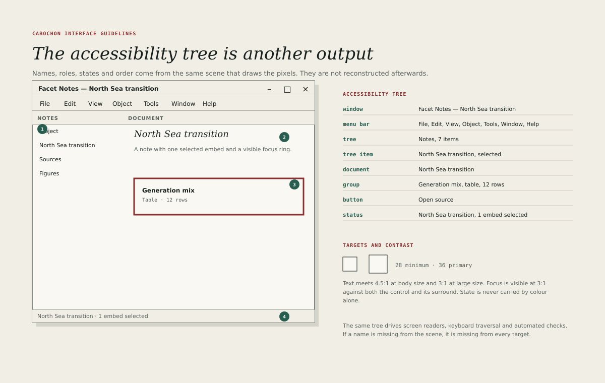

# Accessibility

Accessibility is not a feature added to a finished interface. It is a property
of the scene. Every object that is drawn has a role, a name, a state and a
position in the focus order, and the same scene produces the pixels and the
accessibility tree.

If a name is missing from the scene, it is missing from every target.

## The tree

The accessibility tree mirrors the visible structure.

- A window has a name and a role.
- A menu bar has a name and contains menus, which contain items.
- A tree has a name, an item count and a selected item.
- A document has a name and contains groups.
- A control has a role, a name, a state and bounds.
- A status line has a name and its current text.

The tree must not contain decorative objects, and it must not omit a control
because the control is drawn by a custom widget. A custom widget declares its
role and its children like any other.

## Names

- Every control has a name. An icon-only button takes its name from its
  accessible label, not from its glyph.
- A name describes the action or the content, not the appearance: **Export as
  PDF**, not **Blue button**.
- A group has a name when it groups related controls.
- A name is translated with the rest of the interface.
- A name is unique within its group, so that a screen reader's list of
  controls is usable.
- Placeholder text is not a name. A field with a placeholder and no label is
  unlabelled.

## Roles and states

- Roles use the platform's accessibility vocabulary: button, check box, radio
  button, text field, tree, tree item, tab, dialog, status.
- States are exposed, not implied by colour: selected, checked, expanded,
  busy, invalid, read-only, unavailable.
- A live relationship exposes its state as **Current**, **Refreshing**,
  **Stale**, **Broken** or **Denied**, matching the visible chip.
- A progress indicator exposes its value and whether it is indeterminate.
- A validation error is associated with the field it describes.

A state that exists only as a colour is invisible to a screen reader and to a
colour-blind user. The state chip, the icon and the text carry it together.

## Focus and keyboard

- Every interactive object is reachable by keyboard in a logical order.
- The focus ring is 3 pixels of oxide at 3 pixels offset, visible against both
  the control and its surround.
- Focus is never trapped except in a modal dialog, and a modal dialog returns
  focus to the control that opened it.
- Focus is never moved without a reason, such as opening a dialog or
  revealing a pane.
- Access keys are declared in resources and shown in menus.
- The command palette is reachable by keyboard and announces its results.
- A skipped focusable object is a defect, even if it is reachable by pointer.

## Targets and pointer

- Pointer targets are at least 28 by 28 pixels and 32 preferred; a dialog's
  primary action is 36.
- A small glyph may sit inside a larger target; the target, not the glyph,
  determines the hit region.
- Adjacent targets have at least 8 pixels between their hit regions.
- A drag interaction has a keyboard alternative.
- A context menu is reachable from the keyboard.

## Contrast and colour

- Body text meets 4.5:1 against its background.
- Large text and essential icons meet 3:1.
- Focus indicators meet 3:1 against both adjacent colours.
- A boundary that is required to identify a control meets 3:1.
- Colour is never the only carrier of meaning; every state also has a mark, a
  label or a shape.
- The teal tokens in the palette are decorative and do not carry text.
- The dark theme meets the same ratios as the light theme.

## Motion and timing

- Motion respects the reduced-motion setting and collapses to 0.01
  milliseconds.
- No content flashes more than three times per second.
- A timed action can be extended or disabled.
- An animation never delays the availability of a control.
- A progress state is announced, not only drawn.

## Zoom and reflow

- Interface text does not fall below 12 pixels, and the interface remains
  usable at 200 per cent zoom.
- At 200 per cent, panes may collapse but controls do not overlap.
- Text reflows rather than clipping; horizontal scrolling is acceptable for a
  data grid but not for prose.
- The layout remains usable at the minimum window size declared by the
  application.
- A high-contrast theme replaces the palette rather than tinting it.

## The accessibility output

The `accessibility.json` artefact in the export bundle contains the tree:
roles, names, states, bounds and order. It is generated from the same scene as
the pixels.

A test compares the tree with the scene and fails when:

- a drawn control has no role;
- a named control has no accessible name;
- a state is visible but not exposed;
- the order disagrees with the focus order;
- bounds disagree with the hit map beyond 1 pixel.

## Testing

Accessibility is tested at four levels.

1. **Automated.** The tree is checked against the scene for roles, names,
   states and bounds.
2. **Keyboard.** A reviewer completes the primary task without a pointer.
3. **Screen reader.** A reviewer completes the primary task with a screen
   reader and confirms that every change is announced.
4. **Visual.** A reviewer checks the focus ring, the contrast and the state
   marks at 100 and 200 per cent zoom.

A pass at the first level does not imply a pass at the others. The automated
check proves the tree exists; the manual checks prove it is usable.

## What accessibility is not

- An alternative interface maintained separately.
- A checklist completed after release.
- A reason to remove keyboard shortcuts or compact layouts.
- A synonym for colour contrast alone.
