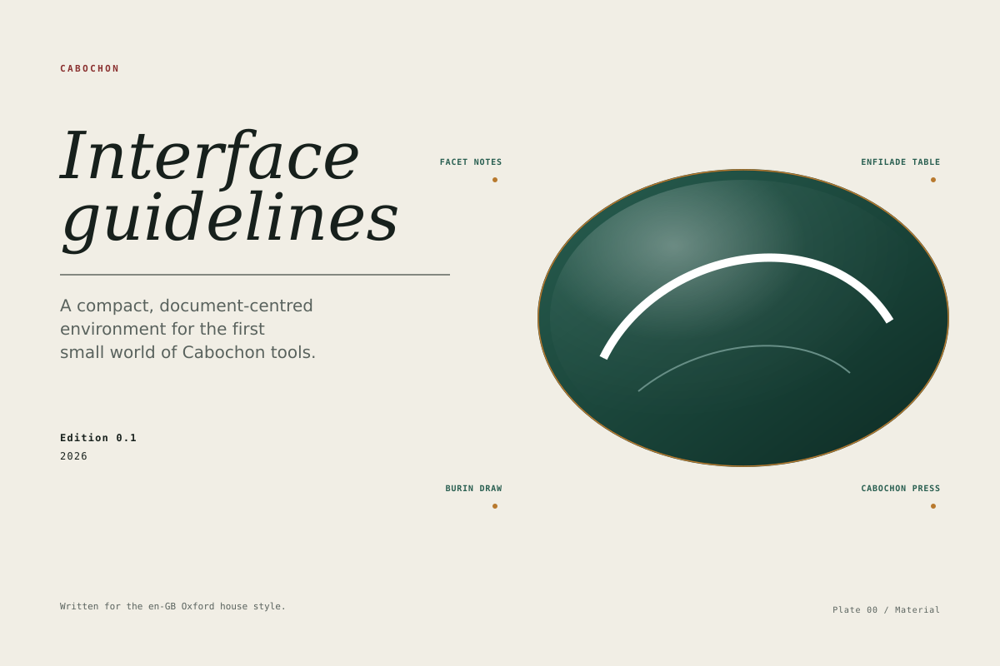

# Cabochon interface guidelines



Cabochon is a compact, document-centred user environment. Its first small world
is a set of contracts, workspace instruments and studio tools that share one
object model, one visual language and one set of interaction habits. This book
is the working manual for that world.

The guidance is deliberately narrow. It describes what the first batch of
Cabochon software must do to feel like one environment, and it leaves the
larger desktop to a later decision. A reader looking for a compositor
specification, a widget-toolkit comparison or a marketing position will not
find one here.

## How the book is organized

The eight parts move from orientation to practice.

<!-- markdownlint-disable MD013 -->

1. **Orientation** — [Purpose](01-purpose.md), [Cabochon
   character](02-cabochon-character.md),
   [Ecosystem map](03-ecosystem-map.md), [The first batch](04-first-batch.md)
   and [Principles](05-principles.md).
2. **The document world** — [The document at the
   centre](06-document-centre.md), [Object identity](07-object-identity.md) and
   [Live relationships](08-live-relationships.md).
3. **Structure** — [Windows](09-windows.md), [Menus](10-menus.md) and
   [Toolbars and status](11-toolbars-status.md).
4. **Visual language** — [Palette](12-palette.md),
   [Typography](13-typography.md), [Spacing and metrics](14-spacing-metrics.md), [Planes and borders](15-planes-borders.md), [Icons](16-icons.md)
   and [Motion](17-motion.md).
5. **Interaction** — [Focus and keyboard](18-focus-keyboard.md),
   [Controls](19-controls.md), [Panes](20-panes.md), [Inspector](21-inspector.md), [Dialogs](22-dialogs.md), [Command palette](23-command-palette.md), [Selection and tools](24-selection-tools.md)
   and [Errors and recovery](25-errors-recovery.md).
6. **The workspace** — [Facet Notes](26-facet-notes.md),
   [Dataframes](27-dataframes.md), [Diagrams](28-diagrams.md), [Bitmaps](29-bitmaps.md), [The formula tool](30-formula.md), [Projects](31-projects.md)
   and [Embeds](32-embeds.md).
7. **The studio and the contracts** — [Burin Draw](33-burin-draw.md),
   [Cabochon Press](34-cabochon-press.md), [Enfilade Table](35-enfilade-table.md), [hello-window](36-hello-window.md)
   and [Output parity](37-output-parity.md).
8. **Breadth** — [Localization](38-localization.md),
   [Accessibility](39-accessibility.md) and the
   [conformance checklist](40-checklist.md).

<!-- markdownlint-enable MD013 -->

[References](appendix-references.md) lists the design traditions and primary
documents that informed the book.

## How to read a rule

The book uses three normative words.

- **Must** marks a requirement. A build that breaks a must is not ready to
  ship.
- **Should** marks the expected choice. A designer may depart from it when the
  departure is deliberate, documented and better for the user.
- **May** marks a permitted option.

Numbers are production values in **logical units** (lu) at 100 per cent
interface scale, with the system font scale at 100 per cent. One logical unit
is one device-independent interface unit: at the baseline it is one physical
pixel at 96 dpi, and the interface scale multiplies it. The book keeps three
coordinate spaces apart — interface, document and sample — and names the one it
means; a figure caption or a legacy note that says "pixel" for an interface
measurement means the baseline logical unit. The distinction is defined in
[Spacing and metrics](14-spacing-metrics.md).

The numbers are starting points for the first small world, not eternal
constants. A change to a number should be argued from a user need, applied
everywhere, and recorded in the figure generator so that the book and the
software cannot drift apart.

Every figure declares its class in its SVG metadata. A **schematic** is drawn
at plate scale to explain a relationship; its measurements are not a
production-size example, and it declares no scale. An **editorial** image is
illustration, such as the cover. A **production reference** is drawn at 1:1
logical units; it declares a canvas and per-component bounds, and the checker
measures those bounds from the drawn primitives and their transforms rather
than from the annotation. Two small fixtures, `fig-prod-chrome` and
`fig-prod-control`, exercise this branch with the catalogue heights.

The machine-readable annotation lives in `tools/figure-data.json`. The checker
validates each state as one record — identity, word, mark, role and colour —
and requires the state inventory declared for each figure. It rejects a mark
with no visible geometry, a hidden or clipped mark, a class or scale that
disagrees with the data, and production geometry whose rendered bounds differ
from the declared bounds. The SVG subset is deliberately narrow: absolute
`M`/`L`/`A`/`Z` paths and `translate`, `scale`, `rotate` and `matrix`
transforms, with clipping attributes refused.
`tools/check-figures.py --self-test` proves each of those negatives is detected.

## Relationship to the design book

The Cabochon design book established the visual character: paper and ink, pine
and oxide, a narrow rail, a masthead, a document plane and a calm instrument
panel. That study was drawn at mockup scale. This book turns it into production
guidance and corrects the places where a mockup's small type would fail on a
real display. In particular, body-size interface text is 12 pixels, metadata is
11 pixels, and 10 pixels is reserved for folios and plate marks.

The visual study is a local, unversioned directory rather than a published
repository. This book therefore does not depend on its path: the values it
borrows are restated here and in [References](appendix-references.md), which
also records the contract basis for every platform dependency. Where this book
and a platform contract disagree, the contract wins. Where this book and a
figure disagree, the generator is wrong and should be fixed.

[References](appendix-references.md) also separates the conformance profiles
from the delivery phases. A profile names the capabilities a surface must
provide; a phase names what the programme is building now. The first batch is a
delivery phase, not a conformance profile.

## Building the book

```sh
make figures      # regenerate the SVG figures
make check        # formatting, lint, spelling, structure, states, keyboard and rendered SVGs
```

The figures are generated by `tools/make-figures.py`. Edit the generator, not
the generated SVG.
